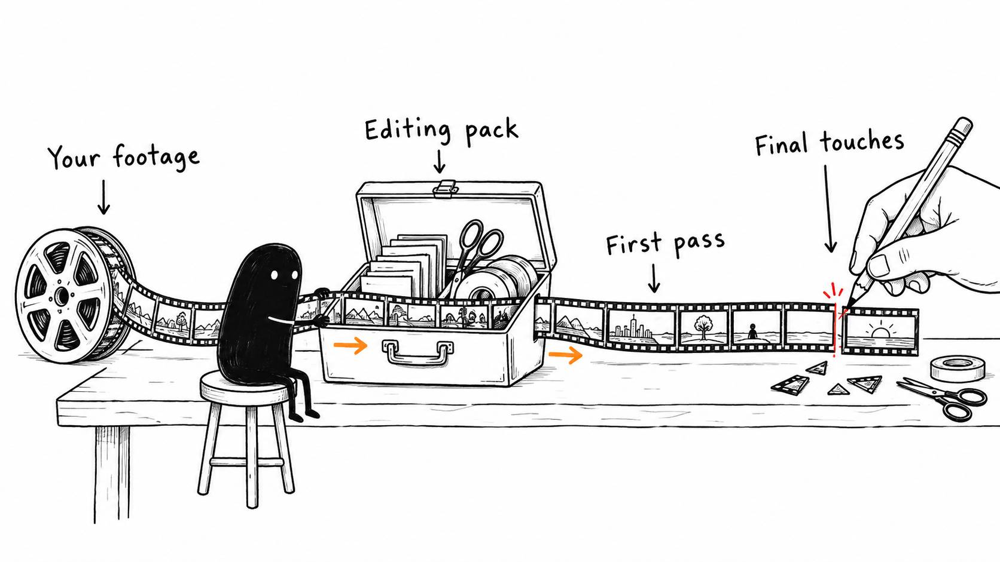

# 01 · Your AI editing pack is here

Reading time: about 3 min.

[**Download your free AI Video Editing Pack.**](https://github.com/paytonbilodeau/ai-video-editing-pack/releases/latest/download/ai-video-editing-pack.zip)

You describe the video you want, and your AI works through the edit using the tools on your computer. Then you watch the result and tell it what to improve. I'm calling that vibe editing.

In my testing, AI gets an edit about 95% to 98% of the way there. That's my experience with my setup, so treat it as a starting point for your own test. The aim is to hand over more of the work while keeping your taste in the finished video.

Start with these three steps. You don't need footage ready yet:

1. **Download and unzip the pack.** A ZIP is a compressed folder. Double-click it on a Mac, or right-click and choose Extract All on Windows. GitHub hosts the download; you don't need an account or coding experience.
2. **Give the extracted Vibe Editors folder to Codex or Claude Code.** These are AI assistants that can work with files on your computer. Keep the whole folder together. [The setup guide](../../AI%20Video%20Editing%20Pack/references/AI%20APP%20SETUP.md) helps if your assistant can't see it.
3. **Paste this message.** The assistant will check your existing tools and help you choose how much to hand over.

> Set up this Vibe Editors folder so you can be my video editor. Read its START HERE guide and follow the setup skill. Ask how hands-on I want to be: careful, balanced, or handle it for me. Reuse my existing tools, permissions, skills and preferences. Keep my originals and projects safe, and keep my private editing profile outside the pack. Explain any new access, upload, installation or cost before using it unless already authorized. Offer useful optional tools, then set up what fits. Verify what works and tell me the simplest next step. No footage is needed for setup.

The download includes the editing skills, pre-edit and motion tools, and [all 22 illustrated lessons](../../Kit%20Email%20Workflow/SEQUENCE.md). You can read ahead and start editing now; the remaining emails walk through the same process one step at a time.

Share which editor you use and what you want to make in [Vibe Editors](https://www.skool.com/vibeeditors) if you would like help. The free pack and guide work independently.

Bookmark [START HERE](../../AI%20Video%20Editing%20Pack/START%20HERE.md) so you can find the setup instructions again.
