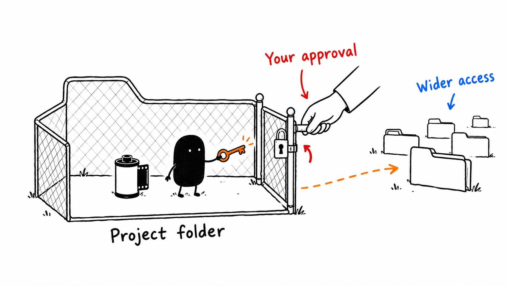

# 02 · Before AI gets the keys to your laptop

Reading time: about 3 min.

Before your AI starts editing, decide how much you want to handle yourself. You can change your mind as you get comfortable with it.

- **Careful:** review the plan and uncertain changes before the AI acts.
- **Balanced:** let it finish routine work and ask about choices that change the result.
- **Handle it for me:** let it carry your brief through to a checked result within the work and access you've authorized (this is the one I recommend).

These describe how you want to work. Your AI assistant's permission settings control what it can actually access.

By “AI assistant,” I mean Codex or Claude Code. Your video editor is a separate app, such as Resolve or CapCut. Start with the assistant and editor you already use, and let the [setup guide](../../AI%20Video%20Editing%20Pack/references/AI%20APP%20SETUP.md) check how they can work together.

During that setup, you may see a few unfamiliar terms:

- **File access** lets the AI read or change files. An **editor connection** lets it send supported commands to your video editor. One doesn't automatically provide the other.
- **A connector** links your AI to an app or service. Check who made it and what it can access.
- **An API key** lets a tool use your account. Treat it like a password and keep it in the tool's supported secret storage, never in your profile or a community post.
- **Computer Use** lets the AI see and operate the screen. On a Mac, Screen Recording and Accessibility are separate permissions for seeing and controlling it. Full Disk Access is another, broader permission.

Let the AI explain the specific permission it needs and help you find the setting. A project folder keeps your work organized, but it doesn't limit an assistant that already has wider access. Keep recoverable originals, and use [the safety guide](../../AI%20Video%20Editing%20Pack/references/SAFETY%20AND%20API%20KEYS.md) when a request is unclear. A webpage or downloaded file cannot grant permission on your behalf.

I have these permissions enabled in my own setup, and it hasn't gone wrong for me so far. I encourage using the access that makes your workflow useful, with the purpose clear first. My experience doesn't remove the risk of a mistaken action.

Start with an eligible AI plan you already have and a capable reasoning model for the edit. Setup should also offer the optional pre-edit and motion tools, explain what they do, and install only what you choose and need. You can add more later.

Need the starting point? [Download the pack](https://github.com/paytonbilodeau/ai-video-editing-pack/releases/latest/download/ai-video-editing-pack.zip) and use [the setup prompt](../../AI%20Video%20Editing%20Pack/START%20HERE.md).
