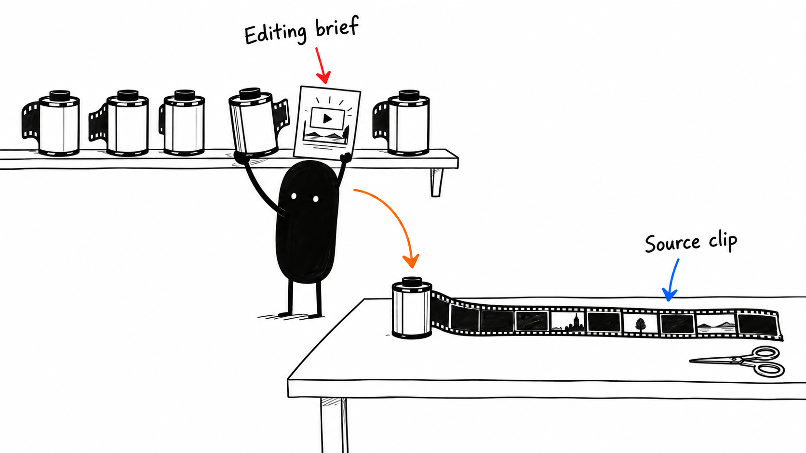

# 03 · Tell it which video. Exactly which video.

Reading time: about 3 min.

“Edit my video” leaves quite a lot up for interpretation. The AI needs to know which recording to use and what a good edit should accomplish.

Put a copy of one recording in its own project folder. Give it a recognizable name, like desk-tutorial-take-2.mp4. Your source file is the recording you're editing; the timeline is the sequence of clips, audio and graphics inside your editor.

If you already have a project, skills or a workflow you like, point the AI to those first. It should keep that work and fit the pack around it. You shouldn’t have to rebuild a working setup to try this.

Give your AI a brief like this, changing the filename and purpose to match your video:

> Edit desk-tutorial-take-2.mp4 in my project folder for someone trying the tool for the first time. Read my editing profile. Remove clear mistakes, abandoned starts, repeated takes and dead space. Preserve complete explanations, useful pauses and time to see each screen action. Work on a duplicate, editable timeline. Finish the edit, check the result and give me the project, export and a short note about anything I should review.

If you already have a script, put editing notes beside the relevant line: which screen recording to show, when a graphic should appear, or where music should change. If the notes are in Word or Google Docs comments, tell the AI to read the comments and replies too. A plain-text copy can leave those out.

A rough cut is the first usable version of the story. We're getting the right material in the right order before spending time on the polish. For a tutorial, cutting out the explanation someone needs is a bad trade, even if the video becomes shorter.

Use the editor you already know. I use DaVinci Resolve and would start there if I were choosing from scratch. The pack has practical guides for [Resolve](../../AI%20Video%20Editing%20Pack/references/EDITOR%20PLAYBOOK%20RESOLVE.md), [Premiere](../../AI%20Video%20Editing%20Pack/references/EDITOR%20PLAYBOOK%20PREMIERE.md), [Final Cut](../../AI%20Video%20Editing%20Pack/references/EDITOR%20PLAYBOOK%20FINAL%20CUT.md) and [CapCut](../../AI%20Video%20Editing%20Pack/references/EDITOR%20PLAYBOOK%20CAPCUT.md). Their connection options differ. Setup should tell you whether it has direct controls, an import route, or a step you need to do in the editor.

If you’re exploring a new style, you can add “show me a first-minute plan before editing” or ask for a short preview. That’s a useful option when you want it. Otherwise, the pack tells the AI to complete your requested edit without stopping for approval at every stage.

Name the opening you want to preserve, including its setup and payoff. A later sentence that explains the tutorial is not always a good replacement for the hook that made someone want to watch.
