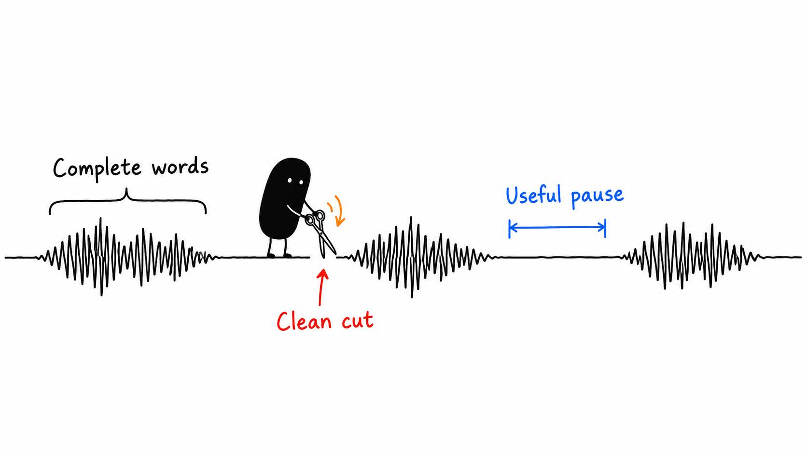

# 04 · Please stop cutting off the end of my words

Reading time: about 2 min.

A cut can look perfectly tidy on a timeline and sound awful when you play it. The end of a word disappears, the next sentence arrives too early, or a tiny awkward gap appears before every clip.

The cut point is where one clip ends and the next begins. Have your AI review a few seconds on both sides with the sound playing. A transcript helps locate the sentence; the recording tells you where the word actually ends.

Don't ask it to remove every silence. A pause after a useful point gives someone time to think. A pause while I forget what I was saying is rather less useful.

A useful correction is specific: “At 00:18, the last sound of ‘click’ disappears. Restore the complete word and replay the join.” Your AI should check every changed transition. You can spend your attention on the moments that don’t feel right.

The [cuts and pacing guide](../../AI%20Video%20Editing%20Pack/references/EDITING%20JUDGMENT.md) gives it more detail, but your ears still get a vote.

Ask the AI to check pauses inside clips as well as between them. Keep reading time when the viewer needs it. After a trim, replay the complete phrase so the quiet ends on both sides do not add up to another awkward gap. If a restart remains, it should fix it or flag the exact moment for you.

P.S. If the whole video feels frantic, more cutting probably isn't the answer. Give the important points room to land.
