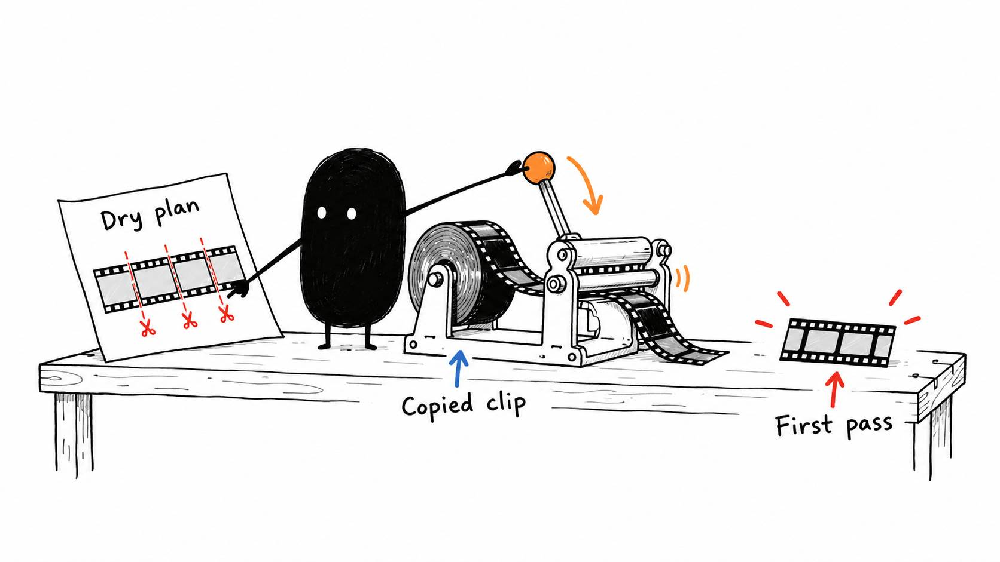

# 05 · The boring first pass can be automatic

Reading time: about 3 min.

Sometimes I want a cleaner recording before getting into creative decisions. The pack's [local pre-edit tool](../../AI%20Video%20Editing%20Pack/skills/pre-edit/SKILL.md) can remove obvious dead space and marked mistakes so the main edit starts with less cleanup.

It normally returns a **clean first-pass video file**, plus a report of the cuts. Open that video in your editor and keep working from there. Your original recording stays available if a cut needs to change.

This step is optional. If you want to adjust individual cuts later, start in an editable timeline or use the timeline-file route below.

If you use spoken restart markers, agree on their meaning before recording. These are the defaults, and you can change them:

- **“Cut cut”** marks a mistake in the current section. Say it, then repeat the thought correctly. Remove the failed attempt and marker, keeping the clean redo.
- **“Full stop restart”** means you're restarting the entire video. Everything before the verified marker is discarded from this first pass, and the new take begins after it. It doesn't delete the source recording.

The AI needs to check each marker against the recording. If you're explaining the phrase “cut cut” in a tutorial, that isn't a request to remove your explanation.

Ask it to prepare the first pass like this:

> Use the included pre-edit tool if it fits this recording. Check my installed tools, then inspect a plan of the proposed cuts before rendering. Keep complete words, useful pauses and demonstrations. Verify the restart markers using the meanings we agreed on. Follow my setup preference for review, preserve the original, and return the checked video and cut report.

That plan lets the AI catch a quiet word mistaken for silence before making the file. You can review it too if you want. Python and FFmpeg run the tool; timed transcript words help it locate markers. Your AI can check those requirements for you. If the source has HDR or several audio tracks, it should choose suitable preparation or use your editor instead.

Prefer separate cuts you can drag around? The [timeline-file exporter](../../AI%20Video%20Editing%20Pack/references/CUT%20LIST%20EXPORT.md) can turn source ranges into an editable timeline for a compatible editor. The pre-edit video is the simpler starting point; the timeline route gives you more control over individual cuts.
