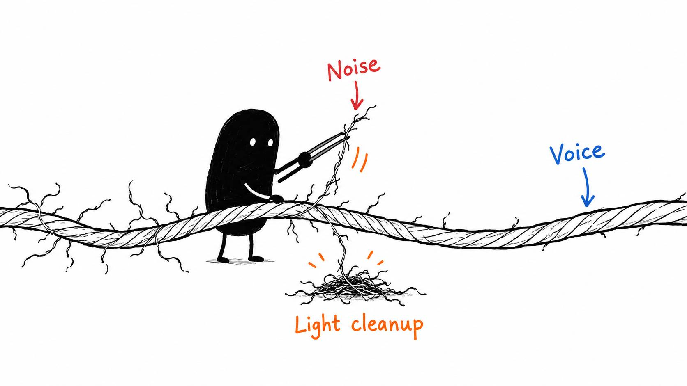

# 06 · Your audio doesn't need to sound aggressively clean

Reading time: about 2 min.

There's a point where noise reduction starts removing bits of your voice along with the noise. Lovely. We've cleaned the recording so thoroughly that I now sound like I'm underwater.

Start by telling your AI which audio to use: camera audio, a wireless mic, a shotgun mic, a dynamic mic, or a separate recording. If you have multiple tracks, have it identify the main dialogue, check sync, and avoid playing two copies of the same voice together.

Then name what you can hear. A constant hiss needs a different fix from a low rumble, room echo, or sentences that keep jumping in volume.

EQ changes the balance of frequencies, such as reducing a low rumble. Compression controls volume differences. Use either because the recording needs it, not because the settings panel looks impressively complicated.

When processing sounds questionable, ask for untreated and treated samples at similar volume. Louder often sounds better even when the processing isn’t helping. Listen for clear words, natural consonants and breaths that still sound like a person. The [audio guide](../../AI%20Video%20Editing%20Pack/references/AUDIO%20GUIDE.md) gives your AI checks for different microphones and recording situations.

For my own final pass, I use [Auphonic](https://auphonic.com/) with presets named for my microphones. I finish the cuts, color, captions and graphics first, then process that export once. It's optional and may cost money. Check the upload and cost before using it, and avoid stacking another full enhancement pass on top.

Headphones reveal small noises; an ordinary speaker reveals whether the voice is easy to follow. The useful result is clearer speech that still sounds like you.

If your video compares untreated and processed audio, mark those exact demonstration ranges before the final pass. Preserve the deliberate difference, including a quiet or muted example. Reuse already accepted audio when only captions or framing change; another enhancement pass can erase the comparison you meant to show.
