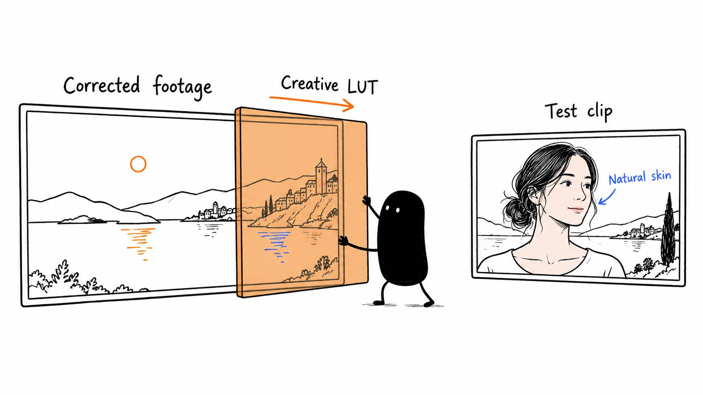

# 08 · Yes, AI can help you make a LUT

Reading time: about 2 min.

You can show your AI a look you like and ask it to help create a LUT for your own video. The reference might be your footage, someone else's video, or a scene from a movie.

A LUT is optional. Use this lesson when you want a particular color treatment; you can finish your first edit with simple color corrections.

A LUT is a file that changes how colors are displayed. Think of it as a reusable color treatment: it can make warm colors warmer, soften contrast, or shift the shadows toward blue. A .cube file is a common LUT format that video editors can import.

Give the AI both **the look you want** and **several frames from the recording you're editing**. The reference shows the style; your own frames show the lighting and colors the LUT has to work with. Say which parts you like, such as the softer contrast, rather than asking it to copy everything.

You can use this prompt:

> Help me create a downloadable .cube LUT inspired by this reference. Use several frames from my recording to adapt it. Check how my footage was recorded and apply the correct viewing conversion before the creative look. Keep skin believable and preserve detail in bright areas. Explain how to import it, then compare it on and off across different shots.

Test it on a different clip too, if you have one. A look that flatters one frame might make the next shot too dark or push skin toward orange. If it only works on part of the recording, reduce the strength or adjust those shots separately.

A LUT changes colors wherever they appear. It can't identify your face and brighten only that area. That needs a separate local adjustment, often made with a mask that selects part of the picture.

[The LUT guide](../../AI%20Video%20Editing%20Pack/references/MOTION%20AND%20LUTS.md) explains that process for your AI. Use the reference to communicate your taste, then judge the result on your own moving footage.
