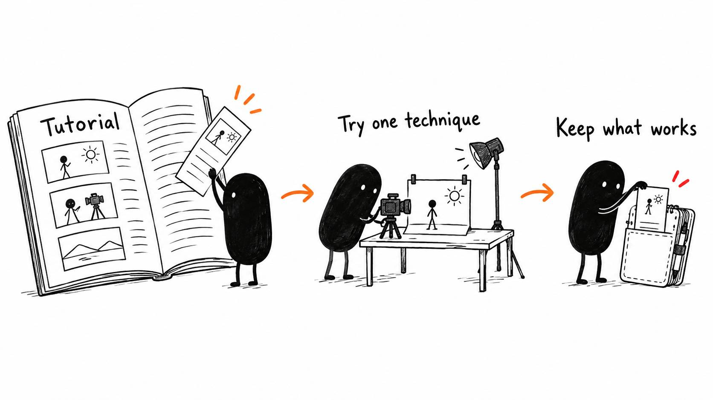

# 10 · Give your AI a better editing education

Reading time: about 2 min.

Better references helped my AI editor. I gave it tutorials, transcripts, documentation and examples from people actually doing the work, then kept the parts that helped my own videos.

Two examples were [Alex's editing process](https://x.com/The_Alex/status/2097847043796725924) and [Future Brian's walkthrough](https://x.com/ForwardEditor/status/2097126303765864768). They discuss the revisions and problems that a polished demo can leave out. X may ask you to sign in.

When you find a useful tutorial, give the AI a specific job: understand the technique, check it against your editor version, and try it on a relevant section of your video. That turns a reference into something you can judge.

For example, a J-cut lets you hear the next shot before you see it. You could begin the next explanation while the current screen demonstration finishes. The point is to make the transition flow without rushing the picture, so watch and listen to the result before keeping it.

For a visual technique, the AI needs to inspect the example itself. A transcript can explain the steps, but it can't show how a graphic moves or whether a cut feels right. Have the AI say whether it watched the video, checked selected moments, or only read the transcript.

Once a technique helps, ask it to save the useful instruction with an example and when to use it. That's how references improve your editing setup. They provide better information for future sessions; they don't retrain the underlying model.

A high-performing video can help you discover a tutorial. It doesn't prove the advice fits your content, editing style or software. Try the relevant part and judge what it does for your video.
