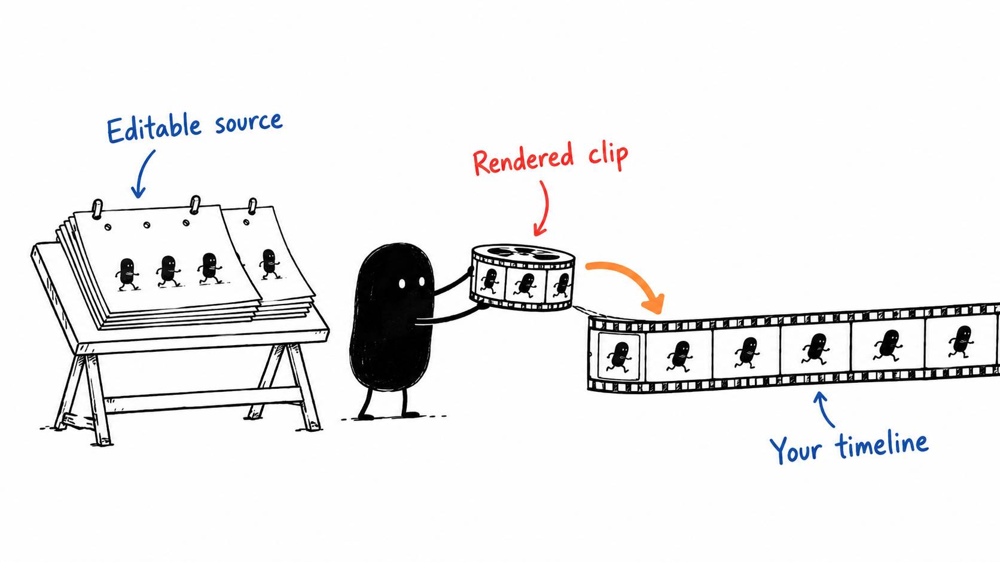

# 11 · You can prompt the motion graphics too

Reading time: about 3 min.

Motion graphics are where this gets especially fun for me. You can describe an animation, have the AI build it, and refine the movement in normal language without writing every line of code yourself.

For a simple title, arrow or callout, start with your editor's tools. A keyframe sets a value at a particular moment. Put a title off-screen at one keyframe and in position at the next, for example, and the editor fills in the movement between them.

For more involved, reusable graphics, [Remotion](https://www.remotion.dev/docs) and [HyperFrames](https://hyperframes.heygen.com/quickstart) give the AI different ways to build them. Remotion uses React components; HyperFrames uses HTML layouts. Both let a coding agent create editable motion projects and render clips for your video editor.

The included [JavaScript animation kit](../../AI%20Video%20Editing%20Pack/skills/javascript-animation/GUIDE.md) is another option. The AI draws and animates with Canvas, a drawing surface inside a webpage. It can render that work on its own or use the included bridge to bring it into Remotion. You describe the result; the AI writes the code.

Ask the AI to offer these options during your first setup, then choose the tools that fit your work. [The motion setup guide](../../AI%20Video%20Editing%20Pack/references/MOTION%20TOOL%20SETUP.md) explains what is installed, what must be added and how to check a first render. The routes can work together. You don’t need to install all of them before making a simple title.

Keep the source project, fonts and approved assets together. A rendered MP4 is useful for playback, but the source is what lets you change the wording or animation later.

If a graphic needs to sit over your footage, ask for a transparent background and a format your editor supports. A normal MP4 has a background. The AI should check the imported clip over the actual shot before calling the overlay ready.

Keep the request tied to the shot: “Build a readable diagram of these three steps while I explain them.” The AI can choose a suitable tool and keep the source editable. We can worry about the grand cinematic universe afterwards.

Time a sound to the visible action, not just the start of its clip. If a card lands at 2 seconds and the sound has 0.2 seconds of silence before its click, start the untrimmed sound at 1.8 seconds or trim that silence first. Check the finished export with sound, and keep the cue separately editable.
