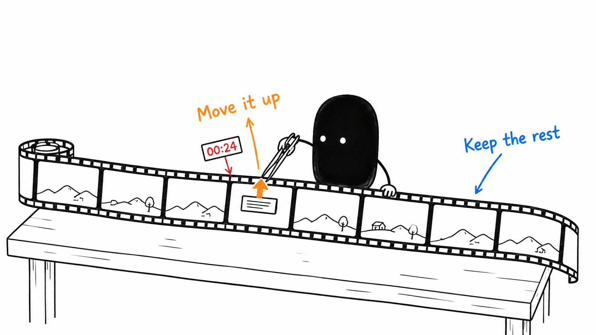

# 13 · “Make it better” is a terrible revision note

Reading time: about 2 min.

When I begin vibe editing, the first attempt is almost never the finished result (but it's getting close). The next step is telling the AI what needs to change clearly enough that it can fix it.

Give it the timestamp from the exact version you're watching, what happened, and what you want instead. “At 00:24, the label covers the button I'm demonstrating. Move it above the button and keep it visible until the click” gives it a specific correction.

The same approach works for pacing: “At 01:08, shorten the pause before the next sentence, but keep the breath and the complete first word.” You don't need a polished prompt. You need a clear description of the problem.

Once your notes are ready, ask:

> Apply these changes to the version I reviewed. Preserve the rest of the edit and keep the previous version recoverable. Check each changed section with a few seconds before and after it, then return the updated project and export. Save clear reusable preferences in my editing profile. Ask if the reason is unclear or a change could be a one-video exception.

Dictating those notes while you watch can be faster than repeatedly pausing to type. Say the timestamp, problem and change out loud, then let the AI organize the notes. I find that more natural too.

For a clear correction, let it fix and check the section. If you're choosing between two looks, ask for a short preview first. Then watch the result to see whether the change did what you wanted.
