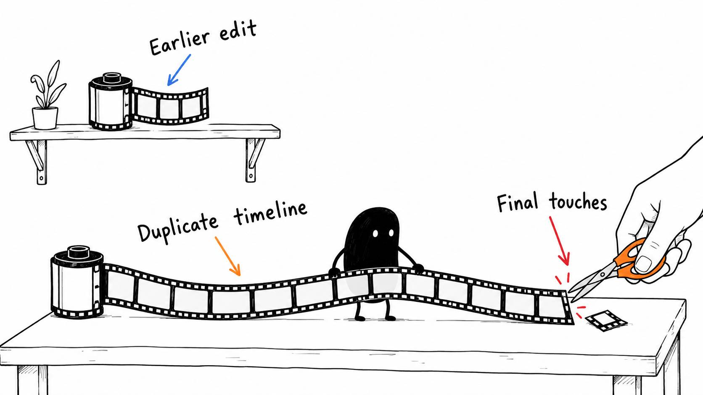

# 14 · When one quick cut is easier to make yourself

Reading time: about 2 min.

Sometimes it's quicker to make a small change yourself than explain it and wait for another version. Open the timeline the AI used, duplicate it, and make your finishing touches there.

Start with playback. The playhead marks the frame you're looking at. Space plays or pauses; J, K and L commonly play backward, stop and play forward. Check your editor's current keyboard preset, since shortcuts can be changed.

Three cutting commands handle a lot of the cleanup. In my custom Resolve preset, I use:

- **Command-X to split** at the playhead, dividing the clip into two pieces.
- **Q to ripple the start** to the playhead, removing the earlier part and closing the gap.
- **W to ripple the end** to the playhead, removing the later part and closing the gap.

Those are my custom keys, not universal defaults. In another preset, Command-X may cut to the clipboard. Ask your AI to show you the matching commands in your editor before trying them. The [Resolve](../../AI%20Video%20Editing%20Pack/references/EDITOR%20PLAYBOOK%20RESOLVE.md), [Premiere](../../AI%20Video%20Editing%20Pack/references/EDITOR%20PLAYBOOK%20PREMIERE.md), [Final Cut](../../AI%20Video%20Editing%20Pack/references/EDITOR%20PLAYBOOK%20FINAL%20CUT.md) and [CapCut](../../AI%20Video%20Editing%20Pack/references/EDITOR%20PLAYBOOK%20CAPCUT.md) guides give it a starting point.

Keep the picture and sound linked, and play the changed join to check that the words still sound complete. If the wrong section moves, undo and check which clips or tracks were selected.

Other finishing touches can be just as straightforward. Select a clip and adjust its volume, brightness or contrast using the editor's controls. Make a small change, compare it with the previous version, and keep what improves the result. Your AI can point out the exact slider or button.

You don't need to learn the entire editor to make these fixes. Keep the earlier timeline so the AI can compare your changes and learn what you preferred. That's the next lesson.
