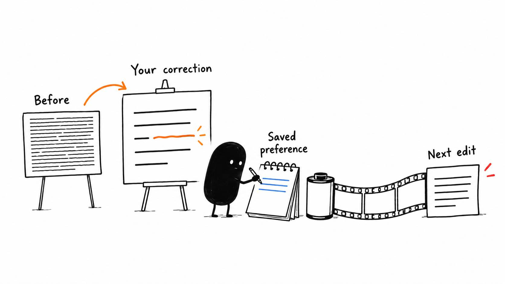

# 15 · Help your AI remember your taste

Reading time: about 3 min.

After you've improved an edit, give the AI a chance to understand what changed. That way, your finishing touches can help the next video too.

Keep the timeline from before your changes and the version you've approved. Ask the AI to compare them using the editor connection. If that connection can't read the relevant changes, provide before-and-after exports and timestamped notes instead.

The comparison shows what moved, but the reason matters too. Keeping a pause because the viewer needs time to read a menu is a useful preference. Keeping every pause would miss the point.

Use this prompt to turn the comparison into instructions:

> Compare my finished version with your previous edit. Explain only changes you can verify. Save useful recurring preferences in my existing editing profile, with an example and when they apply. Preserve the previous profile and any custom skills. Ask if the reason is unclear or the change may be a one-video exception. Show me the file path and exact instruction you saved. Read that profile before my next edit.

Your editing profile is the private file created or reused during setup. It stays outside the pack so an update doesn't replace your taste. [The profile template](../../AI%20Video%20Editing%20Pack/templates/EDITING%20PROFILE.md) shows the kinds of preferences it can hold.

Turn that pause correction into a rule such as: “When a menu must be read, leave enough time for the viewer to read it before continuing.” Save the example's location with the rule. Keep one-video choices in that video's brief.

For the next edit, the AI needs access to that file. If you switch assistants or start in a different folder, point it to the profile again. These saved instructions help it work with your preferences; they don't retrain the model or make every chat remember automatically.

Then check the next result. If it preserves the useful pause without leaving every hesitation, the instruction is doing its job. If it doesn't, use that example to make the guidance clearer.
