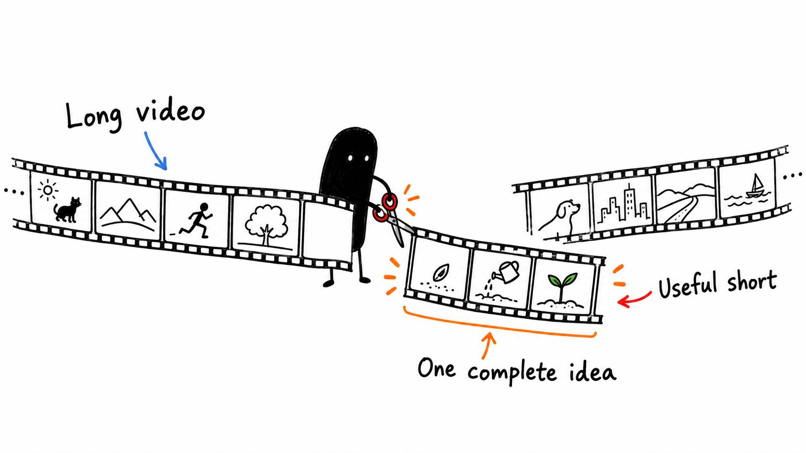

# 16 · One video can give you a very good short

Reading time: about 3 min.

A good short should make sense to someone who never watched the longer video. Pulling out the loudest sentence isn't enough if the viewer needs three minutes of context to understand it.

When you want shorts, ask for them in the same brief or come back to the finished edit later. The AI can choose a complete idea and make the clip. If you’d rather choose first, ask it to suggest candidates.

The full pack includes the [Content Waterfall System](../../10%20Content%20Waterfall%20System/START%20HERE.md): a way to plan useful clips, keep claims tied to the source, prepare captions and check exports. “Waterfall” just means making suitable smaller pieces from a larger piece of content. Choose the formats you want; it does not need to produce every possible derivative.

> Make one strong short from this video for my chosen platform. Select a complete idea with enough setup and a clear payoff. Preserve qualifications that affect the meaning. Use my editing profile, keep the project editable and explain why you chose the section. If no section stands alone, tell me instead of forcing a clip. Check framing, captions and sound, then deliver the short.

A good check is whether a new viewer can follow it. If the clip starts with “this is why it works,” can you tell what “this” refers to? If it promises a result, does it show or explain that result before the clip ends?

If you use a final audio service, build the short from your approved pre-service master. Finish the short, then process its final export once. Running an already enhanced file through the service again can over-process the voice.

I'd rather publish one useful clip than export twenty and hope a few are good. You can still record a separate short when the idea needs a different setup. Repurposing is useful, but it doesn't make every section of a long video worth posting twice.

Have it deliver the source ranges, editable files, finished export and any unresolved checks together. The included tools help prepare the clips; uploading or posting them is a separate action you choose.
