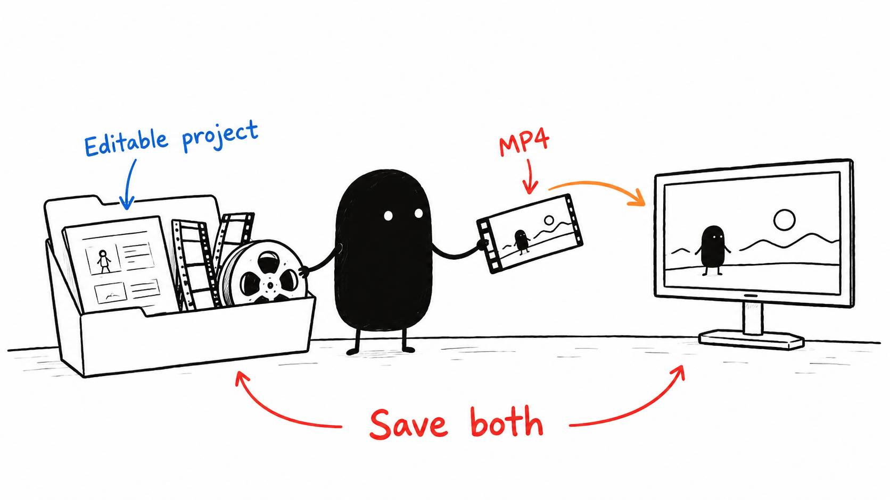

# 18 · The MP4 isn't your project

Reading time: about 2 min.

When the edit is close, watch the final draft in the timeline. You can give the AI feedback as you go, or make the small changes yourself and let it compare the versions afterward.

The timeline lives inside the editable project, where the cuts, sound, captions and graphics can still be changed. Keep that project alongside the video file you'll export.

Once you're happy with the draft, ask the AI to learn from the final changes, save the project, and export the approved version. You can export it yourself too. Use a clear name so it's easy to tell the horizontal video from a vertical short or an earlier draft.

If you began with the standalone pre-edit tool, its clean first-pass MP4 is a starting video you can keep editing. It doesn't contain separate, adjustable source cuts. Keep the original and cut plan, or use the pack's [timeline-file route](../../AI%20Video%20Editing%20Pack/references/CUT%20LIST%20EXPORT.md) when you want those cuts available individually.

For an editor project, keep the footage and other files it uses in place. Moving a source file can leave the project unable to find it, even when the exported video still plays. Have the AI reopen the saved project and check that the media is connected.

If you want an optional final audio pass, use it after the edit is finished, as explained in lesson 6. Save the export from before that pass for later revisions and shorts.

Now open the actual final file and watch it. The next lesson covers that last check before uploading.
