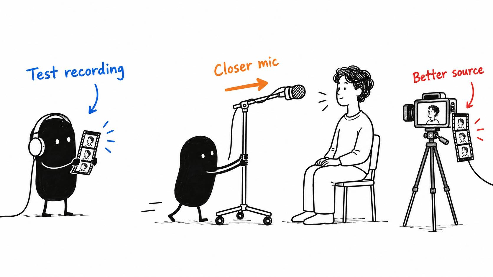

# 20 · Your next edit starts before you record

Reading time: about 2 min.

Some of the biggest editing wins happen before you record. A mic closer to your mouth, a quieter room and a screen recording people can read give the AI much better material to work with.

AI can help clean up a recording. It can't reliably recover the explanation you never recorded or the detail that's already blown out of the picture.

A quick recording check can be useful when you change your camera, microphone or room. A few spoken sentences and a typical screen action can reveal a problem before it appears throughout a longer take.

If you use restart markers, agree on their meaning with the AI before the take. Say the exact phrase clearly, then begin again. A consistent marker gives the pre-edit tool something specific to find; it is more reliable than asking it to guess which repeated sentence you disliked.

Clear speech, a readable demonstration and an exposure that keeps detail in your face give the edit a better starting point. For vertical video, leaving room around important content also makes reframing easier.

Your AI can inspect a sample and suggest a change using the equipment you already own. If it can’t watch or listen, it should say so. Moving the mic closer or enlarging screen text may help more than another round of processing.

The useful comparison is whether the change actually improves the recording. You don’t need a new shopping list every time the audio sounds a bit rough.

I want the AI spending its time on cuts, pacing and useful graphics. If we can fix the source in a few minutes, I'd rather do that than keep asking it to rescue the same recording.
