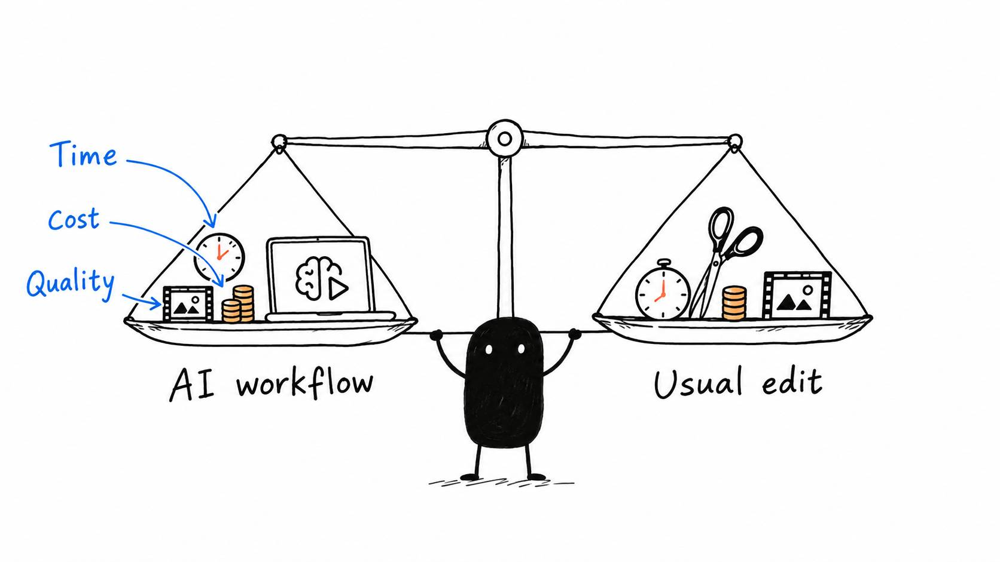

# 21 · Did AI actually save time on this edit?

Reading time: about 2 min.

Did this get you to a video you're happy to publish with less time and energy?

That's the comparison that matters to me. A fast first cut helps, but the full process includes setup, watching, corrections and export. If caption repairs take longer than the cutting saved, the captions need more work.

Compare this edit with how you'd normally handle a similar video. Keep the quality standard the same, and include any extra spending. An AI plan you already pay for is different from a new subscription bought for this workflow.

You don't need a spreadsheet for every edit. A short note such as “The rough cut helped, but the captions covered the demonstration” gives the AI something useful to improve. If you timed the work, add those numbers. If you didn't, keep the comparison approximate.

Then keep the part that worked and fix the part that caused extra effort. In that example, save the successful cut preferences and show the AI where captions can sit without blocking the action. Check whether the next edit needs fewer corrections there.

The setup takes some attention at first, especially while you're teaching it your taste. The reason to keep improving it is to make future edits easier while still producing videos you like.

[START HERE](../../AI%20Video%20Editing%20Pack/START%20HERE.md) stays available if one part of your setup needs another look.
