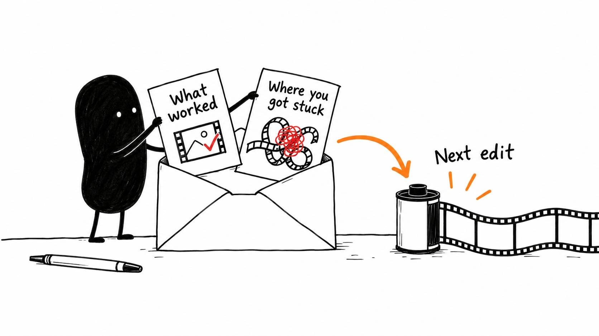

# 22 · Your AI editor, your way

Reading time: about 2 min.

The goal is to save time and energy while making videos you're happy with. Think of it like training an employee: give your AI clear direction, show it what good work looks like, and correct the parts it gets wrong.

Over time, your saved examples and preferences should give it a better starting point. You still judge the result, but you shouldn't have to explain the same taste decisions from scratch on every video.

You've now worked through setup, the first cut, sound and picture, graphics, feedback and the final export. All [22 illustrated lessons are in the pack](../../Kit%20Email%20Workflow/SEQUENCE.md), so return to the part you need when the next project comes along.

For that next edit, give the AI your recording and brief, point it to your editing profile, and let it carry out the work you've agreed on. Watch the result, make or describe your changes, and ask it to save the useful lesson for next time. That's the loop you're building.

Share what worked and where you got stuck in [Vibe Editors](https://www.skool.com/vibeeditors). Include the step, your assistant and editor version, and what happened. If it worked, say what you finished and what you changed by hand.

Those details help me improve the pack and decide what to explain next. I'll keep sharing useful AI and video-editing advice here, and my [YouTube walkthroughs](https://www.youtube.com/@PaytonBilodeau) show the process in action.

Here's the [complete pack download](https://github.com/paytonbilodeau/ai-video-editing-pack/releases/latest/download/ai-video-editing-pack.zip). When updating, ask the AI to follow [START HERE](../../AI%20Video%20Editing%20Pack/START%20HERE.md), compare the new files with your current setup, and preserve your profile, custom skills and projects.
