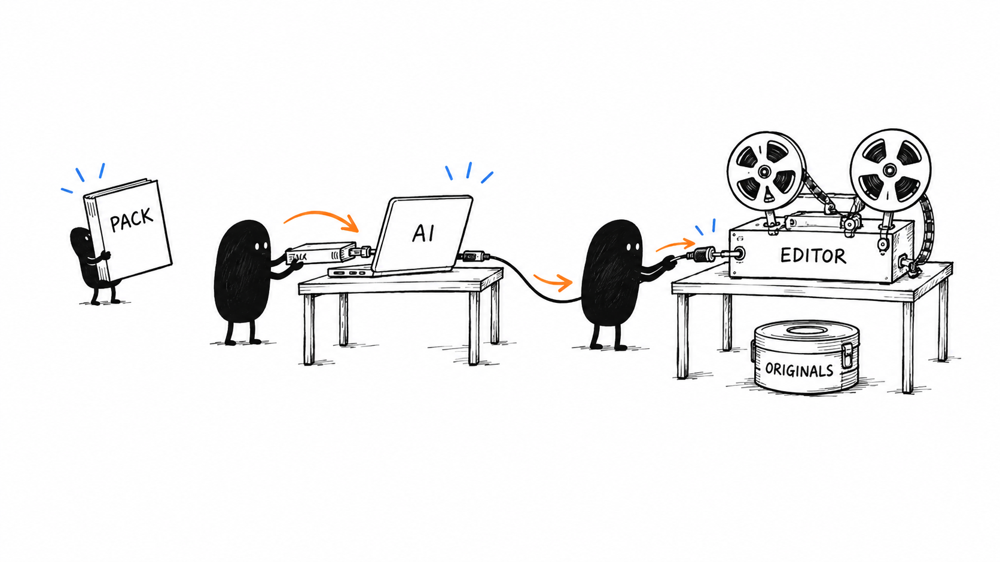
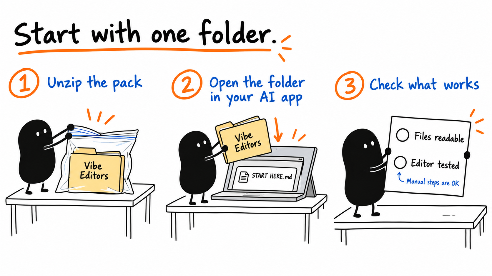
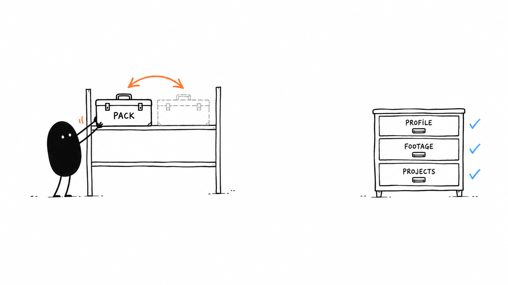
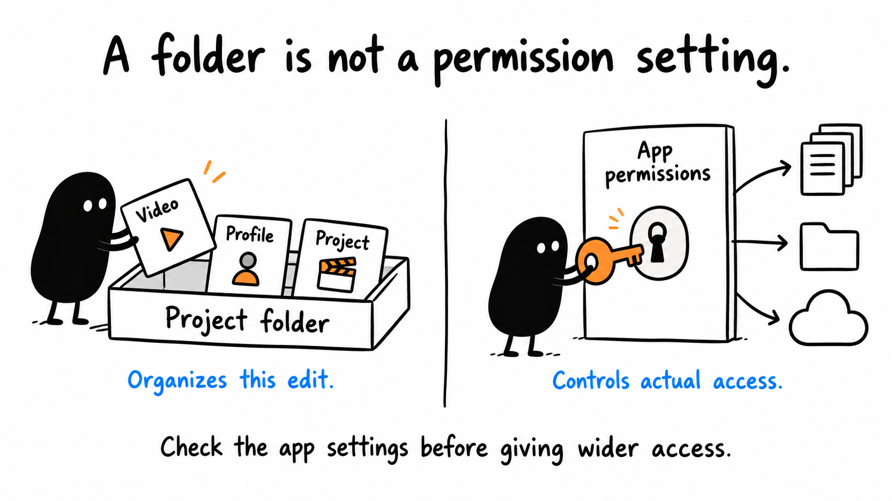

# 01 · Set Up Your Workspace

[Open or download the large infographics](https://drive.google.com/drive/folders/1WmqVZb6UrvRVzjxaZlif9KwEDHSNiP-K)

Anyone with the link can view.

Reading time: about 3 min.

[Download the pack](https://github.com/paytonbilodeau/ai-video-editing-pack/releases/latest/download/ai-video-editing-pack.zip) · [Detailed setup](../lessons/01.md) · [Permissions](../lessons/02.md)

The pack gives your AI instructions. Your video editor holds the edit. These diagrams are illustrations, so the buttons in your app may look different.

## Open the pack



Unzip the download. In Codex, start a Local task in a dedicated editing folder and provide the extracted Vibe Editors folder location. Claude Code is another local assistant option.

```text
List a few files you can read in this Vibe Editors folder before starting setup.
```

## Run setup



Copy this whole message into your assistant. No recording is needed yet.

```text
Set up this Vibe Editors folder so you can be my video editor. Read its START HERE guide and follow the setup skill. Ask how hands-on I want to be: careful, balanced, or handle it for me. Reuse my existing tools, permissions, skills and preferences. Keep my originals and projects safe, and keep my private editing profile outside the pack. Explain any new access, upload, installation or cost before using it unless already authorized. Offer useful optional tools, then set up what fits. List a few files you can read in this pack, show where my private editing profile is saved, and separate editor actions you tested from actions that still need me. Tell me the simplest next step. No footage is needed for setup.
```

## Check what is ready



Keep the pack separate from your private profile, footage and projects. Reuse existing preferences.

```text
Show the pack files you can read, my saved profile path, the editor actions you actually tested, and any steps that still need me.
```

## Choose access deliberately



Your chosen pace controls how hands-on setup feels. App permissions control actual access. “Handle it for me” still works within the access you authorize.

```text
Explain any new access you need and why before expanding it, unless that access is already authorized.
```

If setup gets stuck, give your assistant the step, error and app versions.

[Next lesson: Teach Your Editing Style](02.md) · [All eight lessons](README.md)
