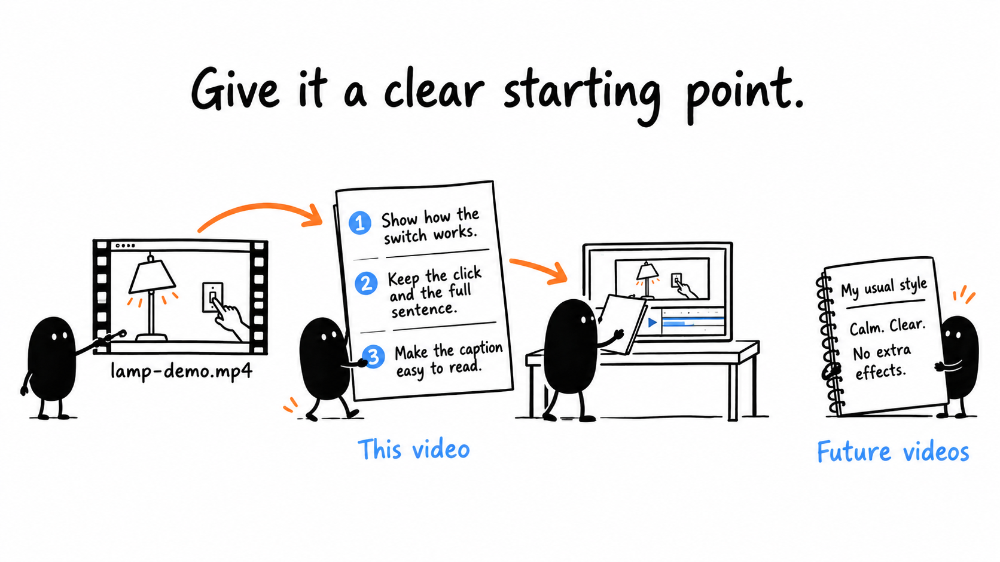
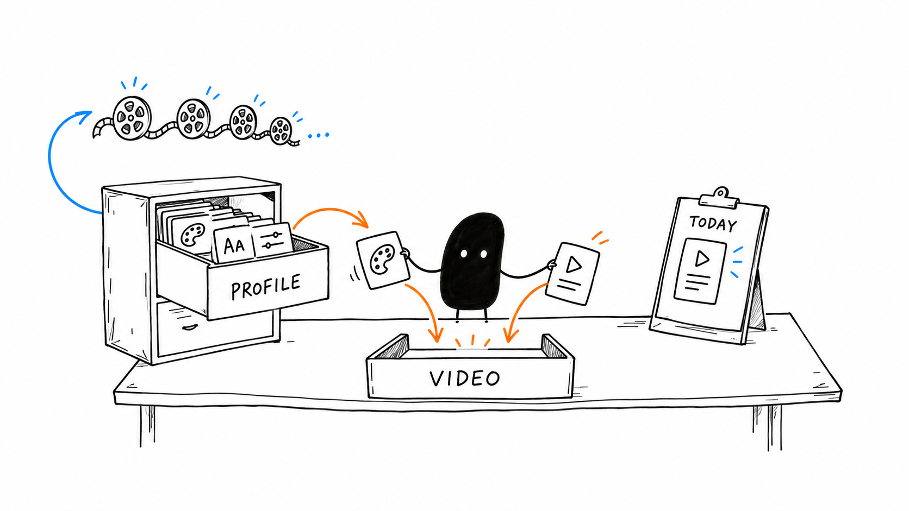
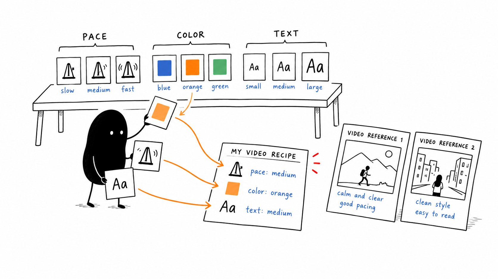

# 02 · Teach Your Editing Style

[Open or download the large infographics](https://drive.google.com/drive/folders/1WmqVZb6UrvRVzjxaZlif9KwEDHSNiP-K)

Anyone with the link can view.

Reading time: about 3 min.

[Detailed brief](../lessons/03.md) · [Saved preferences](../lessons/15.md) · [Optional style examples](../lessons/09.md)

A brief explains this video. Your existing editing profile carries useful preferences between videos. The lamp is an illustrative example; replace bracketed fields with your own details.

## Name the job



For the lamp example, the viewer should understand that the switch turns the light on. Keep the click and enough time to see the result.

```text
Use [source path] to show [audience] how the lamp switch works for [platform]. Keep the useful click, complete words if present, and time to see the result. Make captions readable. Preserve the original and finish the agreed edit.
```

## Reuse your profile



Keep the source, audience, platform and this video’s special choices in its brief. Keep recurring preferences in the profile outside the downloaded pack.

```text
Read my existing editing profile. Use it with this brief, preserve unrelated preferences, and ask only for missing details that change the edit.
```

## Show a reference if useful



A particular pace or label is easier to follow than “make it cinematic.” A custom look is optional.

```text
Inspect [reference and timestamp]. Adapt its [specific useful feature] to my footage. If the look is unfamiliar, show a short preview first.
```

The separate playable lamp practice uses synthetic images and a click, with no recorded speech. The illustrated spoken examples do not describe a human recording.

[Next lesson: Make Your First Cut](03.md) · [All eight lessons](README.md)
