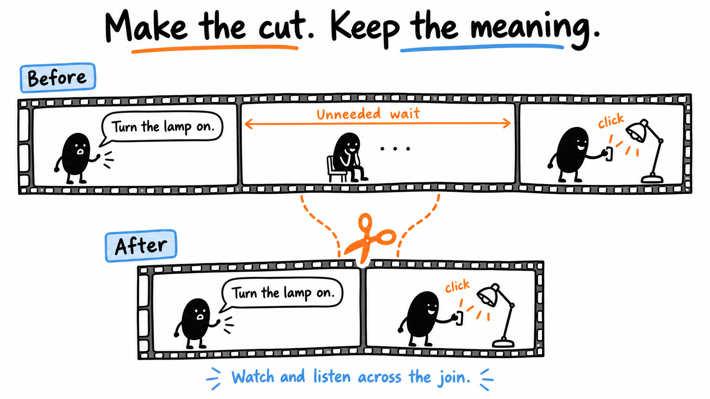
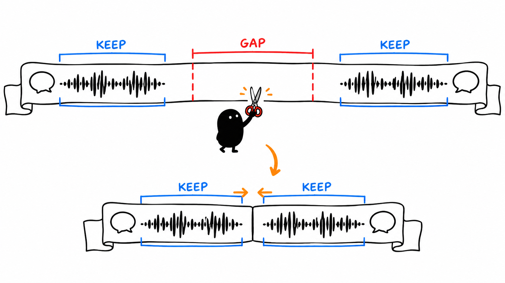
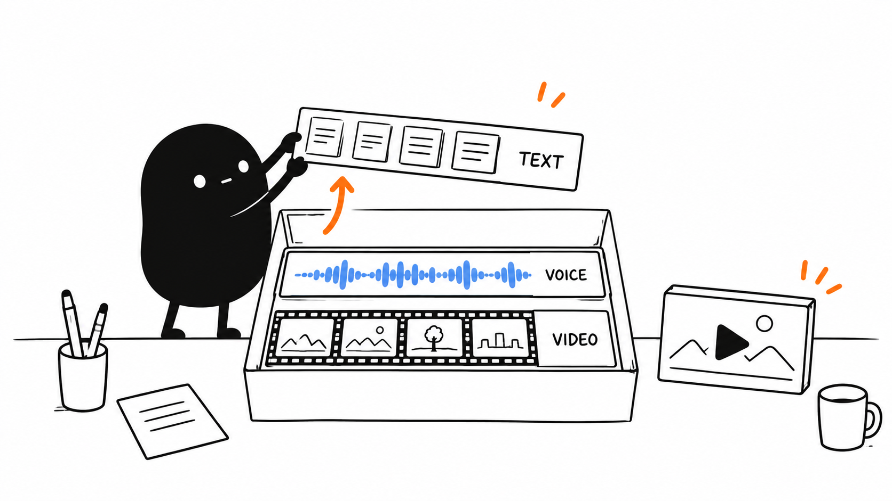

# 03 · Make your first cut

[Open the included lamp practice](<../../Practice/synthetic-lamp/START HERE.md>) · [Open the cutting image](assets/03-cut.png)

Reading time: about 2 min.

Keep enough for the viewer to follow. Try this on your recording or the lamp practice.



## 1. See what the cut changes

Unzip the practice and open its start guide. Play source.mp4, too-short.mp4 and corrected.mp4 with sound. The mistake loses the click; the correction keeps it and time to see the result. These are synthetic pictures and a generated click, with no human voice.

## 2. Make the first cut

```text
Use my brief and profile to make a first cut in my editor’s supported editable timeline. Work on a duplicate; preserve the source. Remove mistakes, repeated takes and unused waits. Keep complete words and thoughts, the opening’s setup and payoff, useful sounds and time to follow each demonstration. Replay changed joins with sound and a few seconds on either side. Reopen the saved timeline, check linked media and report any manual step.
```



Listen for clipped words and rushed sentences. The recording tells you where words finish. Keep pauses that let the viewer read or follow an action.



## 3. Check what stays editable

An editable timeline lets you adjust cuts. The optional pre-edit tool returns a first-pass video and cut report instead. Its guide also explains spoken restart markers; agree on their meaning before recording.

More detail: [Complete words and pauses](../lessons/04.md) · [Optional pre-edit](../lessons/05.md) · [Editable timeline guide](../../AI%20Video%20Editing%20Pack/references/CUT%20LIST%20EXPORT.md).

[Next: Clean up sound and picture](04.md) · [All eight lessons](README.md)
