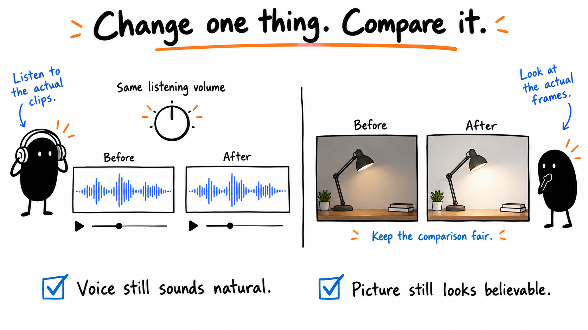
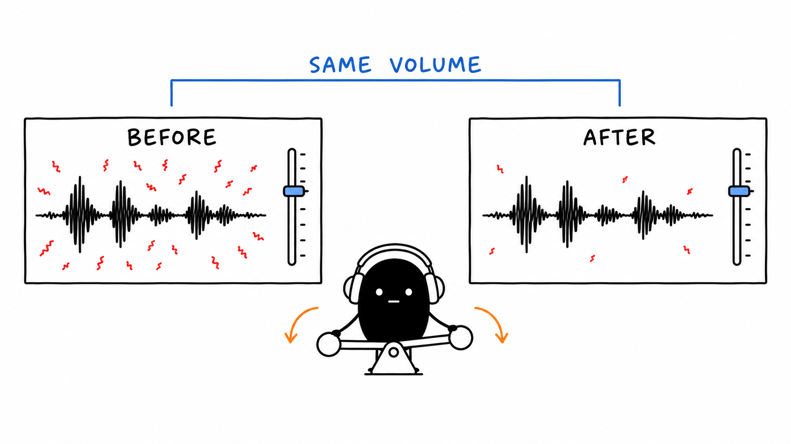
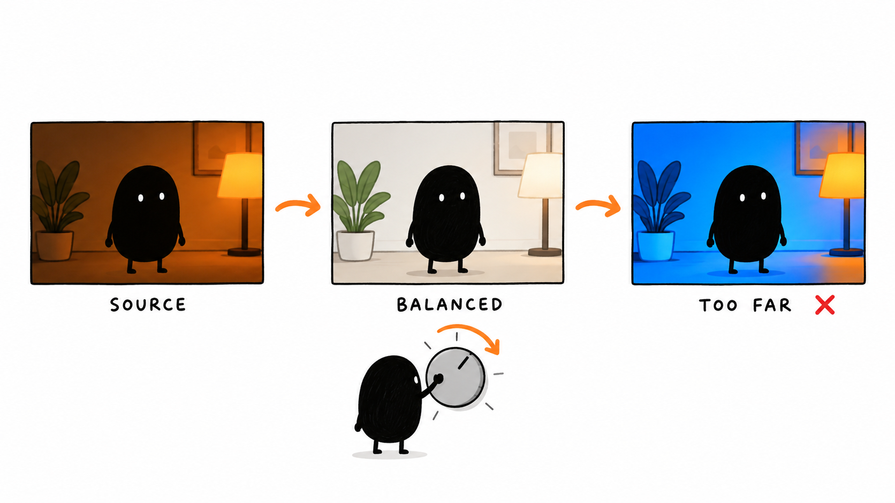

# 04 · Clean Up Sound and Picture

[Open or download the large infographics](https://drive.google.com/drive/folders/1WmqVZb6UrvRVzjxaZlif9KwEDHSNiP-K)

Anyone with the link can view.

Reading time: about 3 min.

[Natural audio](../lessons/06.md) · [Picture correction](../lessons/07.md) · [Optional LUTs](../lessons/08.md)

Change sound or picture only when something needs fixing. The comparisons below are illustrative; an image cannot prove that audio improved.

## Compare one change



Start with the actual problem. The lamp practice needs its useful click preserved; it is not a human voice-cleanup or filmed color-correction example.

```text
Identify a specific sound or picture problem in my source. Compare a short section before and after one change. Keep the original and explain what the actual comparison shows.
```

## Listen at similar volume



For recorded speech, use the recording from the intended microphone. Compare on headphones and a speaker, keeping natural speech and any deliberately untreated examples.

```text
Match the comparison clips to a similar listening volume. Check whether the problem improved without damaging speech or useful sounds. Keep the change only if it helps.
```

## Correct before adding a look



Check the camera’s color settings, brightness and unwanted color casts. Look across actual shots, including skin when present. A creative LUT is optional.

```text
Use my camera settings and source frames to correct only what needs it. Keep adjustments editable. Compare several moments and preserve believable skin and bright detail.
```

Optional Auphonic finishing comes after cuts, color, captions and graphics, once per export. Keep the pre-service version for revisions.

[Next lesson: Add Useful Graphics](05.md) · [All eight lessons](README.md)
