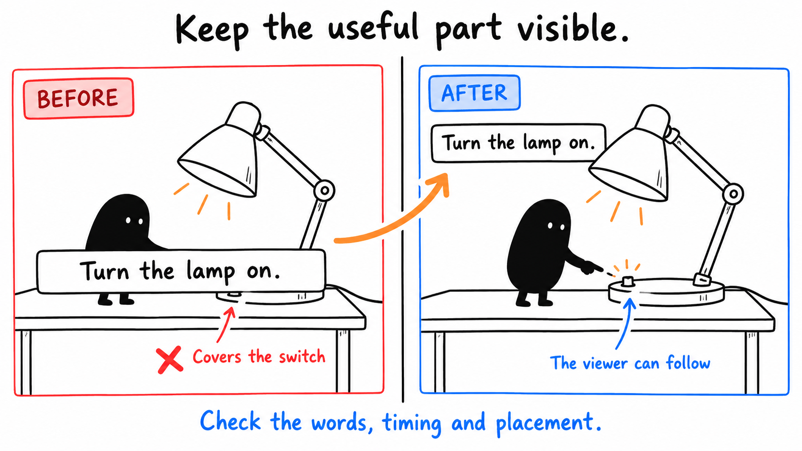
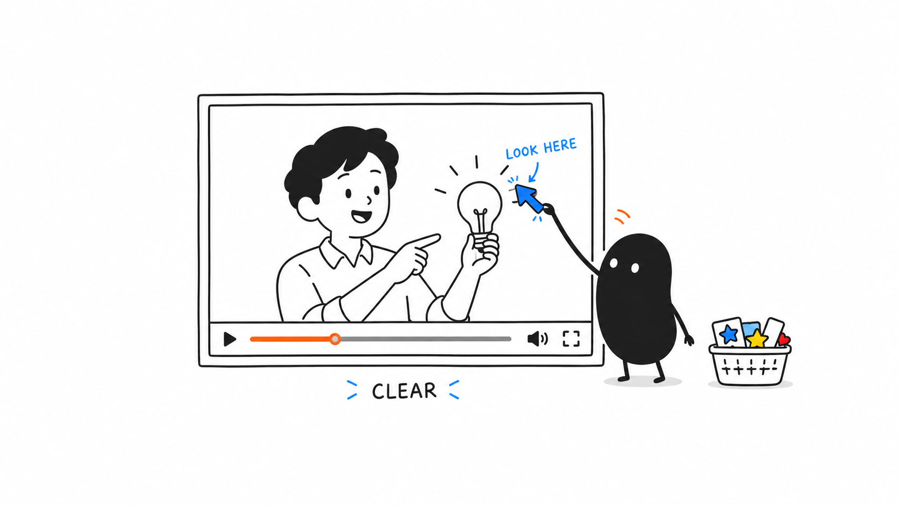
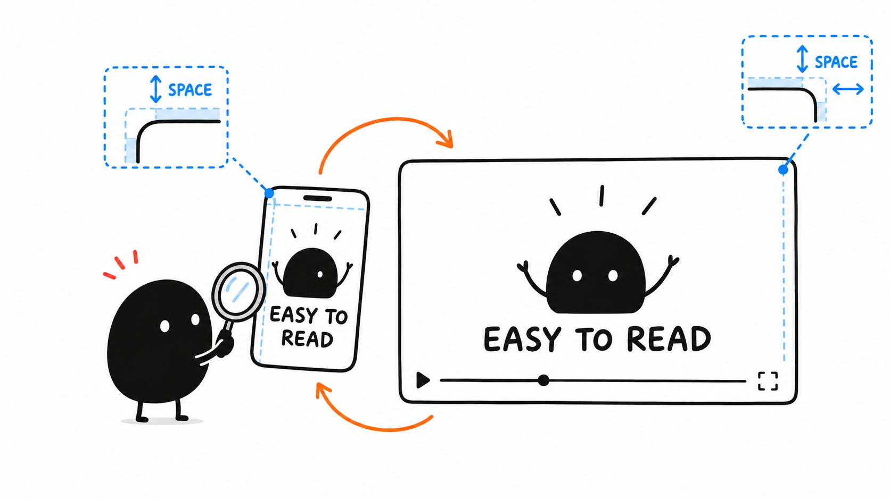

# 05 · Add captions and useful graphics

[Open the caption image](assets/05-caption.png) · [Detailed caption guide](../lessons/12.md) · [Lamp practice](03.md)

Reading time: about 2 min.

Moving the caption lets the viewer see the switch. Keep the words readable and the useful action visible.



## 1. Create the captions

For spoken footage, paste this message:

```text
Create captions from this video's final cut, or import my subtitle file and align it to that cut. Correct names, numbers and punctuation against the recording. Keep each line readable, time it to the speech, and keep it clear of faces and the demonstration. Keep the captions editable. Return captions built into the video or a separate subtitle file as my destination requires, then check the export at normal speed and phone size.
```

For the lamp practice, import corrected.srt and align “[synthetic switch click]” with the click at 00:02 in corrected.mp4. Check its placement. There is no speech to transcribe.



## 2. Add a pointer if it helps

Use an arrow, label or diagram to explain something hard to see. Keep it editable. Add custom motion only when it helps.



## 3. Watch at the viewing size

Play at normal speed and check spelling, timing and reading time. For vertical video, use your phone and keep important content clear of platform controls.

Keep editable captions. Check the delivered subtitle file or export too.

More detail: [Optional motion graphics](../lessons/11.md) · [Vertical framing](../lessons/17.md).

[Next: Fix what needs changing](06.md) · [All eight lessons](README.md)
