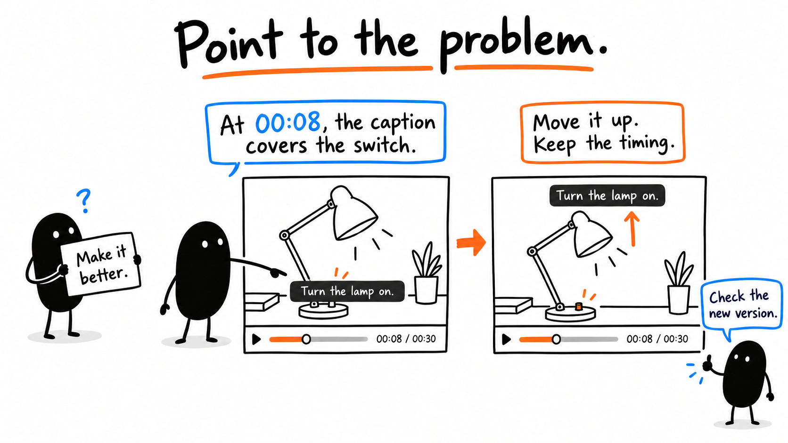
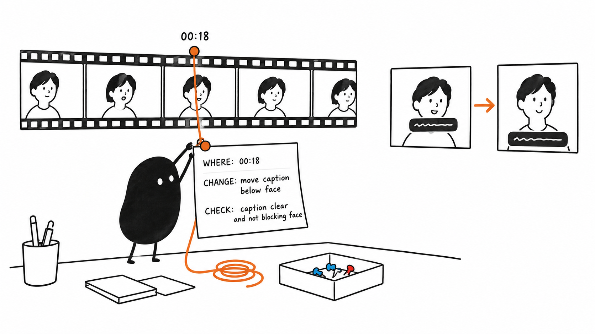
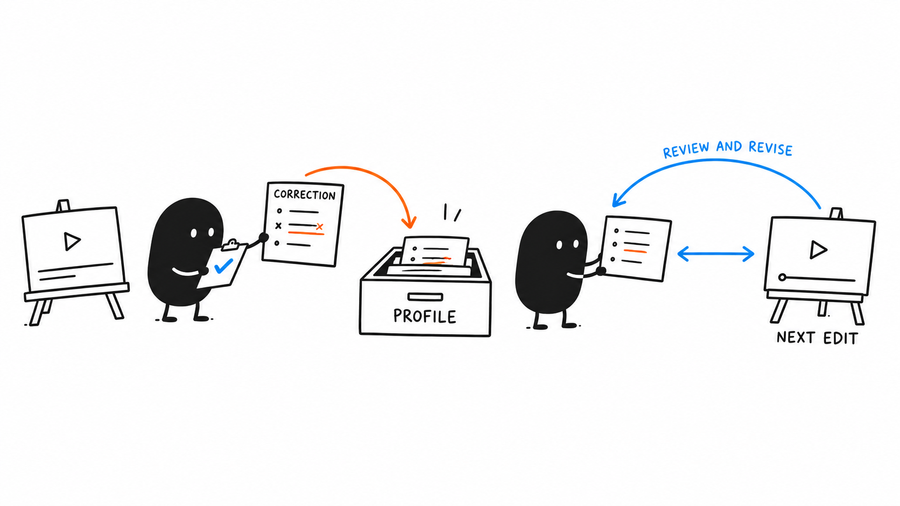

# 06 · Give Feedback That Sticks

[Open or download the large infographics](https://drive.google.com/drive/folders/1WmqVZb6UrvRVzjxaZlif9KwEDHSNiP-K)

Anyone with the link can view.

Reading time: about 3 min.

[Detailed feedback guide](../lessons/13.md) · [Manual finishing](../lessons/14.md) · [Saving preferences](../lessons/15.md)

Name the exact version, timestamp, problem and change. The times in these illustrations are examples; use the times from the file you actually reviewed.

For the [lamp practice](03.md#try-the-lamp-practice), try this note: “In too-short.mp4, at the cut around 00:02, the switch click is missing. Restore the action and click from source.mp4 while keeping the shorter wait.” Compare the result with corrected.mp4.

## Point to the problem



For the lamp example, the problem is the caption covering the switch. Replace the brackets below with your reviewed file and time.

```text
In [reviewed filename/version] at [timestamp], the caption covers the switch. Move it into clear space above the action. Keep its timing and the rest of the edit unchanged.
```

## Check the revision



A good note says what success looks like. You can dictate it or make a small change yourself; preserve the earlier version.

```text
Save a new version and replay the changed section with sound. Confirm the caption is readable, the switch stays visible and no nearby word or action was lost.
```

## Carry the reason forward



After you accept the correction, keep its reason with the example. Lesson 8 shows how to save a recurring preference without turning every one-video choice into a rule.

```text
Record the accepted before-and-after versions and why the change helped. Keep this video’s exact caption placement in its brief.
```

If the revision still misses the point, describe the remaining visible or audible problem and replay the next version.

[Next lesson: Export and Check Your Video](07.md) · [All eight lessons](README.md)
