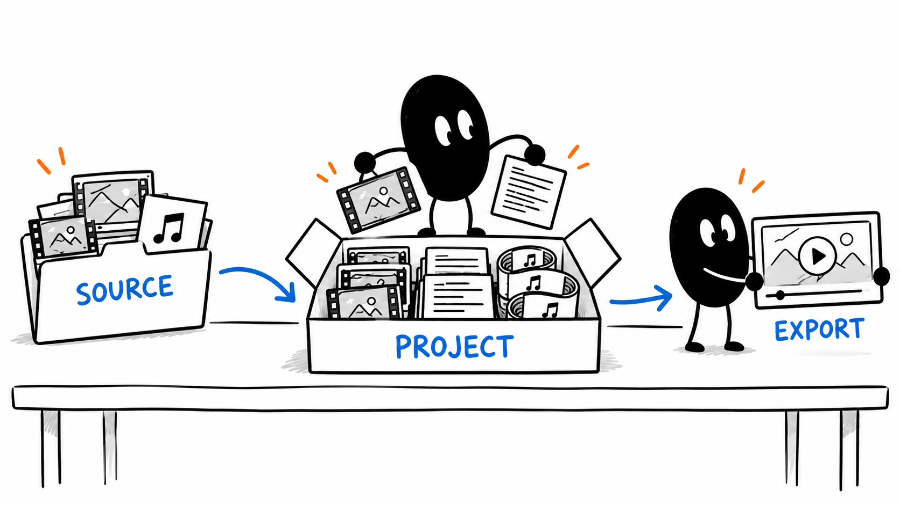
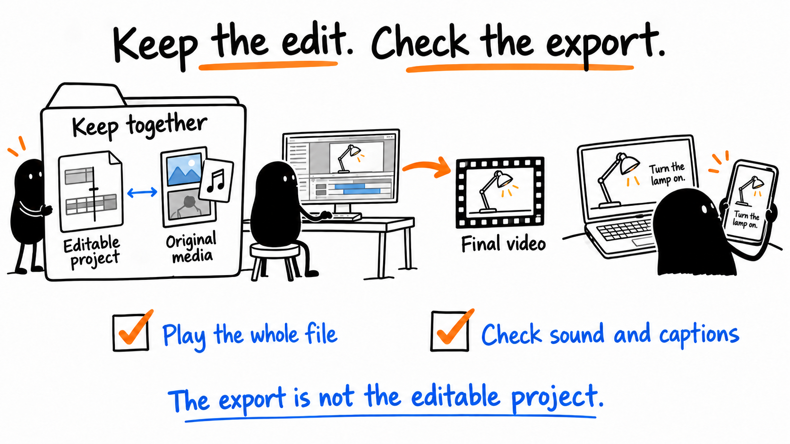
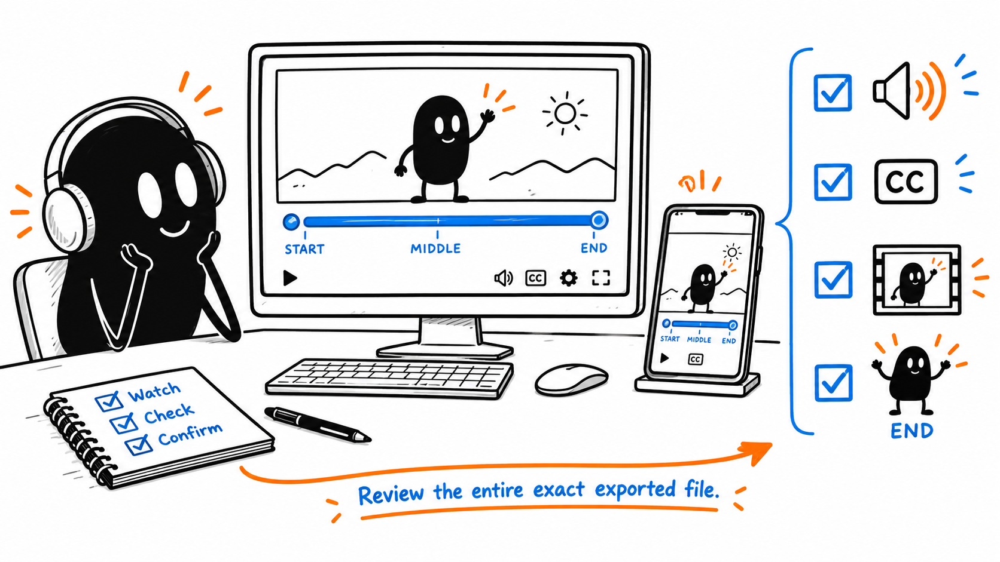

# 07 · Export and check your video

[Open the export image](assets/07-delivery.png) · [Export checklist](../../AI%20Video%20Editing%20Pack/templates/DELIVERY%20AND%20LEARNING.md)

Reading time: about 2 min.

Keep the source, editable project and export. The project lets you change the edit; the export is what people watch.



## 1. Save the project and export

```text
Save and reopen the reviewed editable project. Check its source media, captions, graphics and fonts; report missing or unsupported items. Export for [destination] as [filename] and give me the exact location. Check the file’s picture, sound, sync, captions and ending. Report checks performed and remaining manual checks. If needed, fix the project, export again and recheck. Preserve the original and earlier versions.
```



For the practice, keep source.mp4, the supplied cut/timeline files and corrected.mp4. Follow its start guide to import and relink the timeline, then check it inside your editor.

## 2. Watch the actual file



Watch the whole export at normal speed with sound, including the first and last frames. Listen across cuts and read captions. Check vertical work on your phone. Decide whether the result feels right.

Use optional final audio processing once, after the visual edit. Keep the pre-service export and check the returned file’s sound and sync.

More detail: [Keep the project](../lessons/18.md) · [Final watch](../lessons/19.md).

[Next: Save what worked and start again](08.md) · [All eight lessons](README.md)
