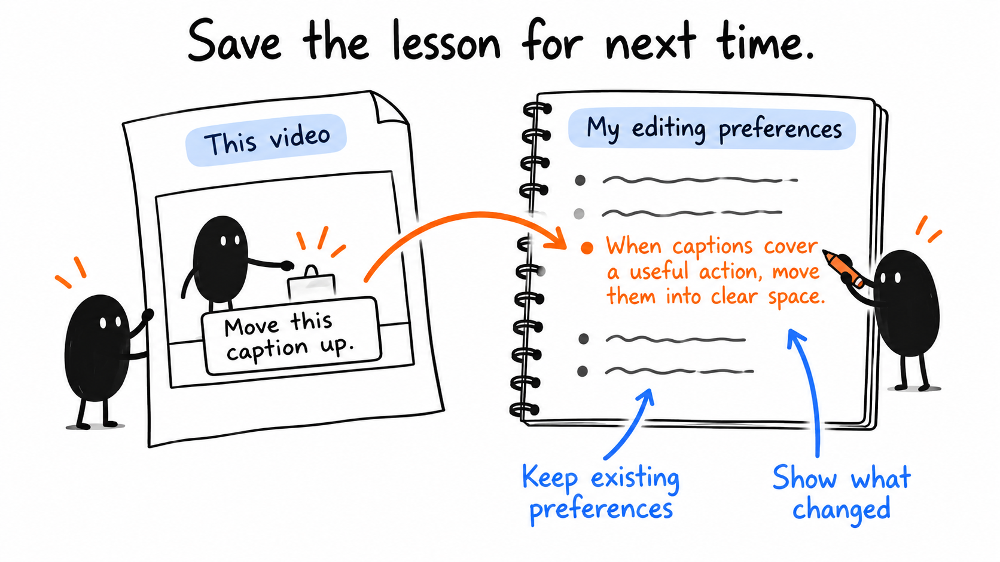
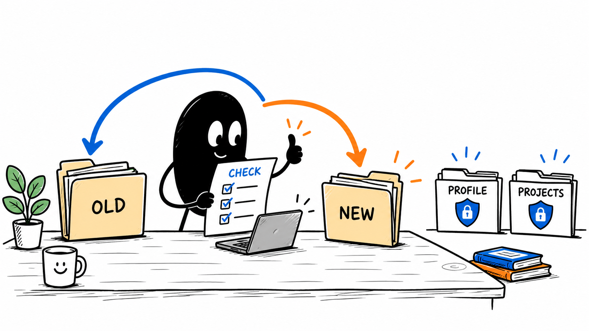
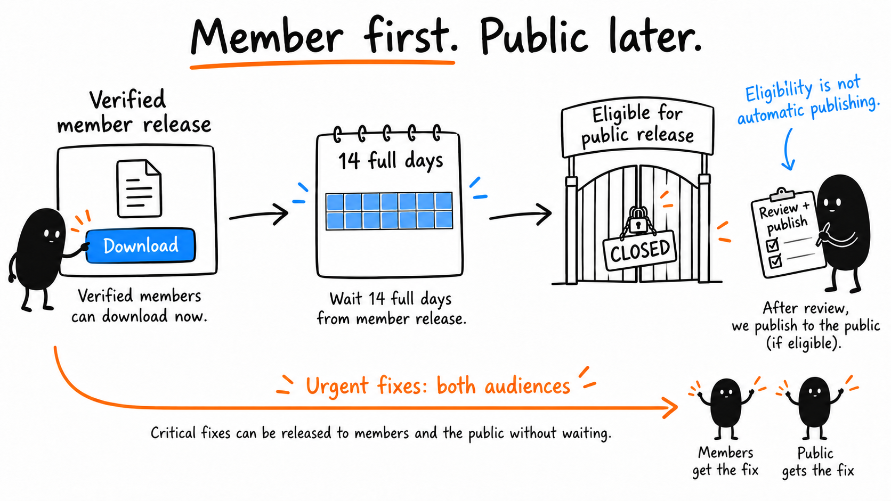

# 08 · Repeat and Keep It Updated

[Open or download the large infographics](https://drive.google.com/drive/folders/1WmqVZb6UrvRVzjxaZlif9KwEDHSNiP-K)

Anyone with the link can view.

Reading time: about 3 min.

[Preference guide](../lessons/15.md) · [Update instructions](../../AI%20Video%20Editing%20Pack/references/UPDATING.md) · [Release history](https://github.com/paytonbilodeau/ai-video-editing-pack/releases)

An accepted correction helps the next video when the AI can find and apply it. Reuse the same private profile with a new recording and brief.

For the [lamp practice](03.md#try-the-lamp-practice), save this conditional preference: keep a useful action sound with the action and leave time to see the result. The 2–9-second selection belongs only to that exercise; it is not a timing rule for other recordings.

## Save the useful condition



The lamp lesson is to keep captions clear of useful actions. The exact position belongs to this video. A new chat may need the profile supplied again.

```text
Use this accepted correction to update my existing private editing profile: keep captions clear of the action they explain. Save the example and when the rule applies. Preserve the previous file and other preferences. Keep this video’s exact placement in its brief. Show the saved path and changed text. Read the profile before the next edit.
```

## Update without losing your work



Use the instructions for the actual release. Back up first, compare versions, and keep custom skills, profiles and projects recoverable.

```text
Compare this release with my installed pack. Back up affected files, preserve my customizations and private work, and show any conflict before replacing it. Verify the setup after the update.
```

## Check what has actually shipped



New features become eligible for public release after 14 full days from verified member release. Review and publishing are separate steps. Critical fixes can reach both audiences without waiting.

```text
Open the dated release entry and identify its version, available download and current release status before choosing an update.
```

For the next recording, check a short test with sound. LUTs, motion graphics and repurposed shorts remain optional. Judge the finished video and the time and effort it took.

[Start your next edit: the brief](02.md) · [All eight lessons](README.md)
