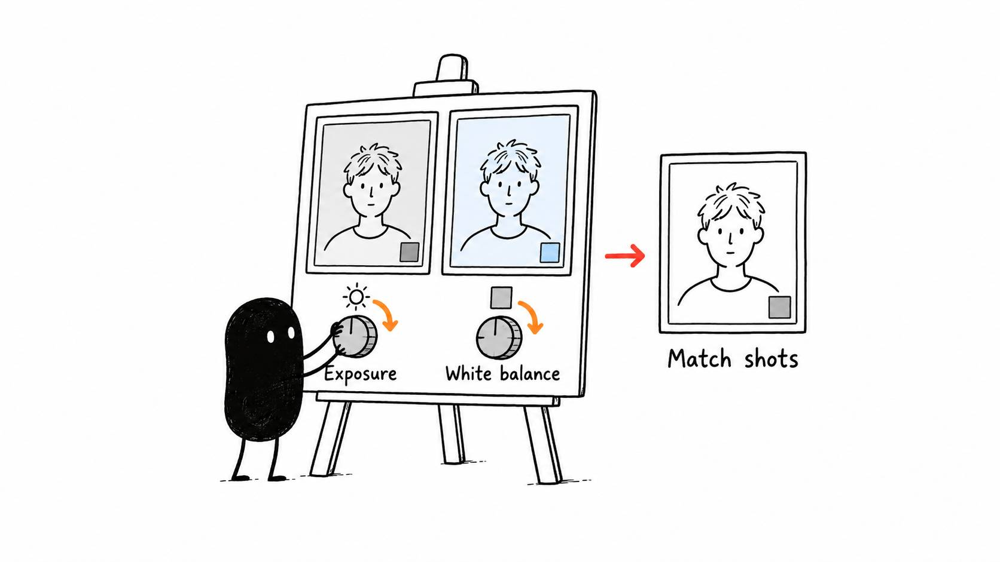

# 07 · Fix the picture before making it cinematic

Reading time: about 2 min.

If your skin looks orange in one shot and blue in the next, start by fixing the picture before adding a dramatic look.

Ask the AI to check exposure, which controls brightness, and white balance, which removes an unwanted color cast. Then compare neighboring shots so they look like the same scene.

To do that properly, the AI needs to know how the footage was recorded. Log footage often looks flat until the editor converts it for viewing. HDR can hold a wider brightness range than standard video. Your camera settings help the AI choose the right conversion, so it shouldn't guess from a washed-out image alone.

Once that conversion is right, it can make small corrections where needed. Ask it to use the editor's scopes, which measure brightness and color, alongside the actual picture. That helps catch lost detail in a bright window or a color cast that is easy to miss on your display.

Check a few different moments in the recording, especially if the lighting changes. Skin should look believable and bright areas should retain detail. A shot that already looks right may need very little.

Keep the adjustments editable so they can be changed later. [The color and LUT guide](../../skills/style/references/MOTION%20AND%20LUTS.md) gives your AI the detailed checks. The next lesson is an optional way to add a look. If the picture already suits your video, you can keep it as it is.
