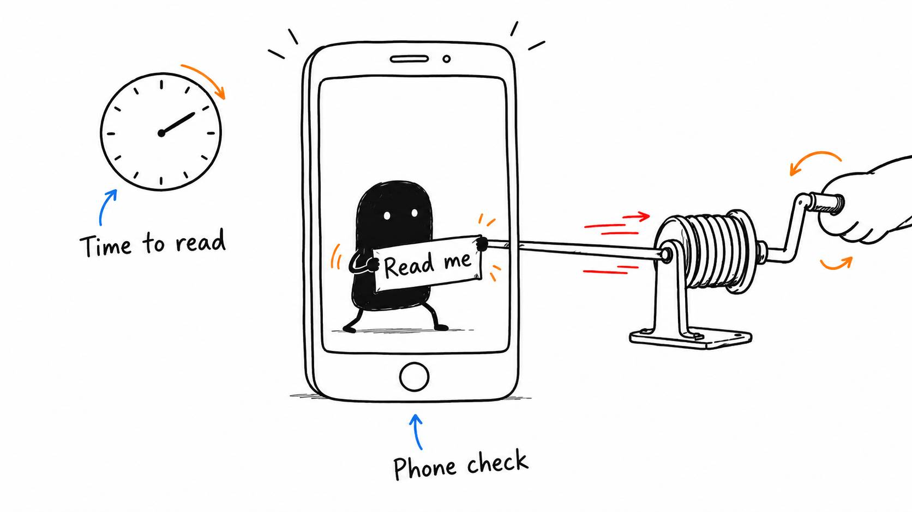

# 12 · The graphic looks good. Can anyone read it?

Reading time: about 3 min.

A graphic needs enough time to be seen, understood and, if it contains words, read. Even a good animation can miss the point if it disappears while you're still explaining it.

Give it a clear job, such as showing which button you're pressing or how two ideas connect. Then time it to the words and action it explains. “Keep this label visible until I finish showing the setting” is useful feedback.

For a vertical short, usually 9:16, watch it on your phone at normal speed. Can you see the whole graphic, understand it, and read any text without pausing? If a label is tiny or the screen feels crowded, enlarge the important part and remove what isn't helping.

Also leave room for the platform's controls. Reels, TikTok and Shorts can place buttons, account information and captions over the top, right and bottom of the video. **Safe zones** are the clear areas where essential text and graphics won't be covered. Check the intended platform's current preview, since the overlays vary.

Keep the main composition centered. Scale it down or move an individual label when needed, rather than pushing the whole design to one side. Lesson 17 looks more closely at framing faces and demonstrations inside that space.

For a horizontal video, often 16:9, check it on the screen viewers are likely to use, such as a laptop. The same test applies: the graphic should arrive with the idea and stay long enough to make sense.

Once the cuts are settled, use this prompt for readable captions:

> Create captions from this video's final cut, or import my subtitle file and align it to that cut. Correct names, numbers and punctuation against the recording. Keep each line readable, time it to the speech, and keep it clear of faces and the demonstration. Keep the captions editable. Return captions built into the video or a separate subtitle file as my destination requires, then check the export at normal speed and phone size.

When a full-screen graphic covers a camera cut, its background must cover the first frame of that cut. The text can animate in afterward. The [dedicated-short example](<../../skills/remotion/examples/dedicated-short/README.md>) shows the frame before, at and after the handoff. If you choose its single-line captions, measure each phrase with the real font and split long phrases at natural breaks. Other formats keep their own caption settings.

If a label does the job, it probably doesn't need a bounce, glow, whoosh and three arrows too. I'm reminding myself of that one.
