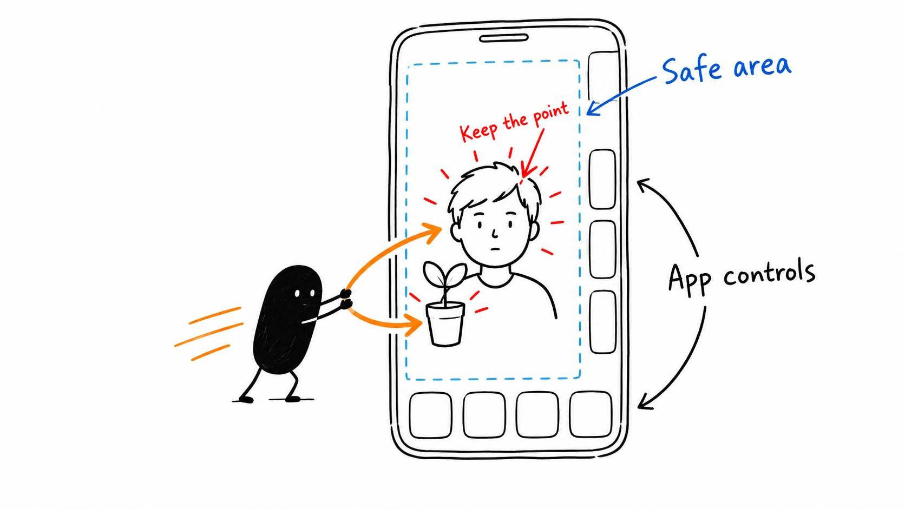

# 17 · Your vertical crop can hide the whole point

Reading time: about 2 min.

Your face can be perfectly centered in a vertical crop while the button you're explaining is outside the frame. Excellent tutorial (smh).

Start with your editor's automatic reframing when it's available. [CapCut has Auto Reframe](https://www.capcut.com/tools/auto-reframe), which can move the framing with the subject. Availability and Pro requirements vary, so have your AI check your installed version and account first.

For a moving speaker, ask the AI to use the editor's tracking or animated position controls to follow the face smoothly. It should keep a steady composition, rather than chasing every tiny head movement. If it loses the face or switches to another person, correct that section and watch it again.

The pack's standalone crop tool keeps one fixed crop. For face-following, use the editor route described in [the reframing guide](../../skills/edit/references/core/REFRAMING.md). The AI can operate supported controls or show you the exact manual step.

Then check what else needs to remain visible. A tutorial may work better with your face above the screen recording, or with a wider view that keeps the important button in frame.

Open Instagram Reels, TikTok or YouTube Shorts and notice where the interface covers the video: the top labels, right-side buttons and bottom caption area. Keep important content inside the clear space, often called the safe area. Check the intended platform's preview too, since those controls change.

Keep your main composition centered and leave room around it. If it overlaps the interface, scale it back or adjust the layout instead of pushing everything left. Watch the full short to make sure the face, graphics and demonstration stay visible as the shot moves.
