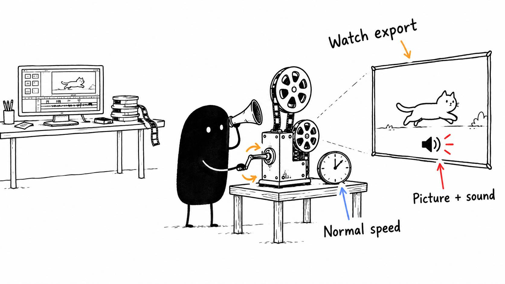

# 19 · Watch the file, not just your timeline

Reading time: about 2 min.

Watch the actual video you're about to upload, from beginning to end, with sound. That catches problems you might miss in the editor, including something introduced during export or the final audio pass.

Normal speed gives you the best chance of noticing clipped words, awkward cuts and graphics that disappear too soon. I often rewatch at 1.5×, sometimes 2×, depending on how well I can stay focused. Faster playback is convenient, but it can hide small problems, so replay anything questionable at normal speed.

Pay attention to the opening and ending, changes in voice level, and whether each graphic appears when it makes sense. Read captions as they play. For a vertical short, check it on your phone with room for the platform's controls.

When something is wrong, pause and give the AI the timestamp from that file. Ask it to correct the section in the editable project while preserving the rest. Then watch the corrected section in the new export, including a few seconds before and after it.

The AI should also inspect the frames around changed graphic entrances, exits and transitions. A few still images can miss a brief flash or a caption covering your face for one frame. Its check and your watch serve different purposes: it looks for technical problems, while you decide whether the video feels right.

Before posting, confirm you're uploading that newest file. A corrected timeline won't help if yesterday's export is the one you select.
