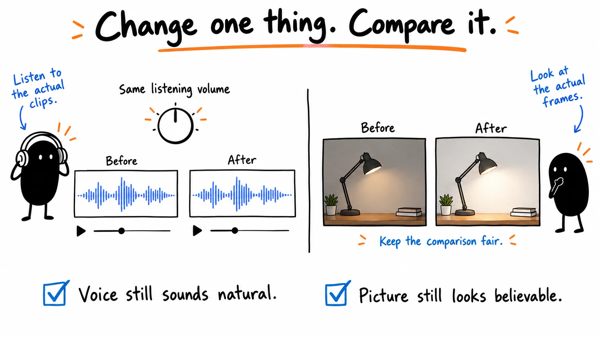
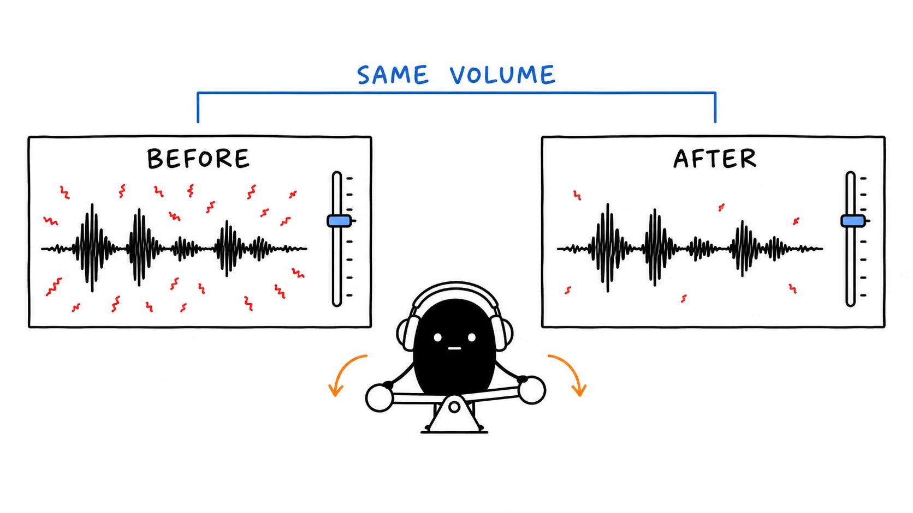
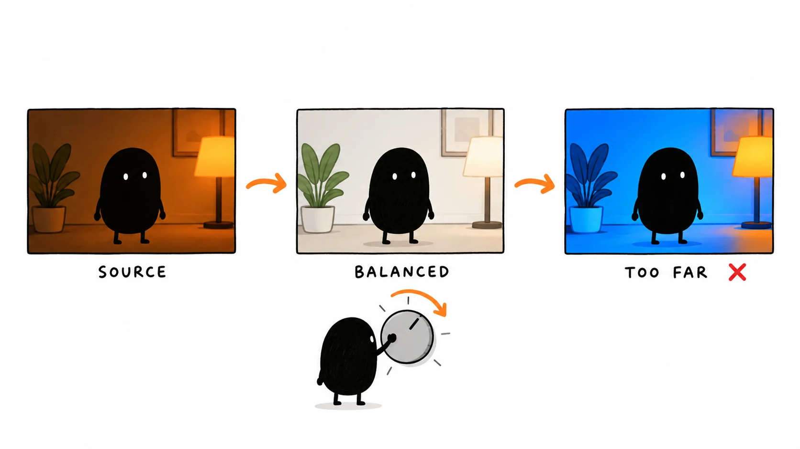

# 04 · Clean up sound and picture

[Play the speech comparison](https://drive.google.com/file/d/1sYl8TFlGRHolZVvbiQ0rKqNKx3yTFH7_/view) · [Download the practice files](https://drive.google.com/file/d/1mYnfEJ_gQl3udWe8mWFYjr2iMG3XYfL9/view) · [Open the comparison image](assets/04-compare.webp)

Reading time: about 2 min.

Fix a specific problem, such as hum or a dark shot, then compare the same section before and after.



## 1. Hear the difference

The same speech plays twice at matched volume: A adds artificial hum; B reduces it. Listen for the noise and naturalness of the voice. This constructed example is not a raw-microphone or Auphonic comparison. If Drive will not play it, download the file.



Compare on headphones and an ordinary speaker at similar volume. Louder can seem better even when the voice has not improved.

## 2. Correct your recording

```text
Fix the sound or picture problems in my source. Use the intended microphone, keep sync and avoid duplicate voice tracks. Compare each correction at similar volume; preserve natural speech, useful sounds and deliberately untreated demonstrations. Check camera settings before converting footage or correcting brightness and color. Compare several moments, preserve believable skin and bright detail, and keep adjustments editable. Preserve the original and report any check you could not perform.
```



## 3. Keep the changes that help

Use your moving footage to judge color. The drawings illustrate a balanced picture and an excessive look. A creative LUT is optional.

Optional Auphonic comes after cuts, color, captions and graphics, once per export. Keep the pre-service version for revisions or shorts.

More detail: [Natural audio](../guide/06.md) · [Picture correction](../guide/07.md) · [Optional LUTs](../guide/08.md).

[Next: Add captions and useful graphics](05.md) · [All eight lessons](README.md)
