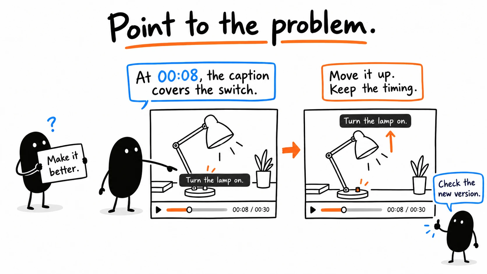
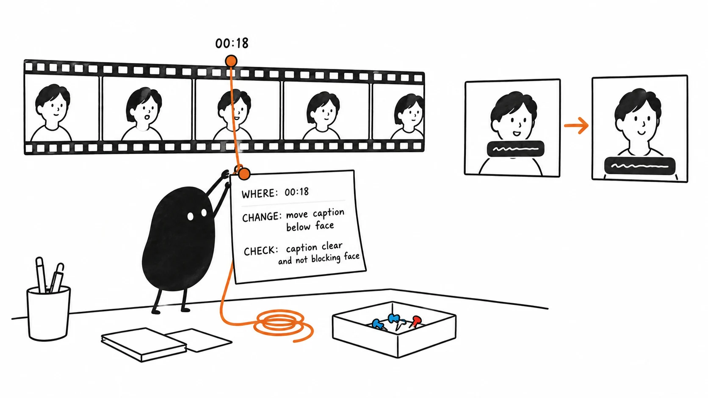
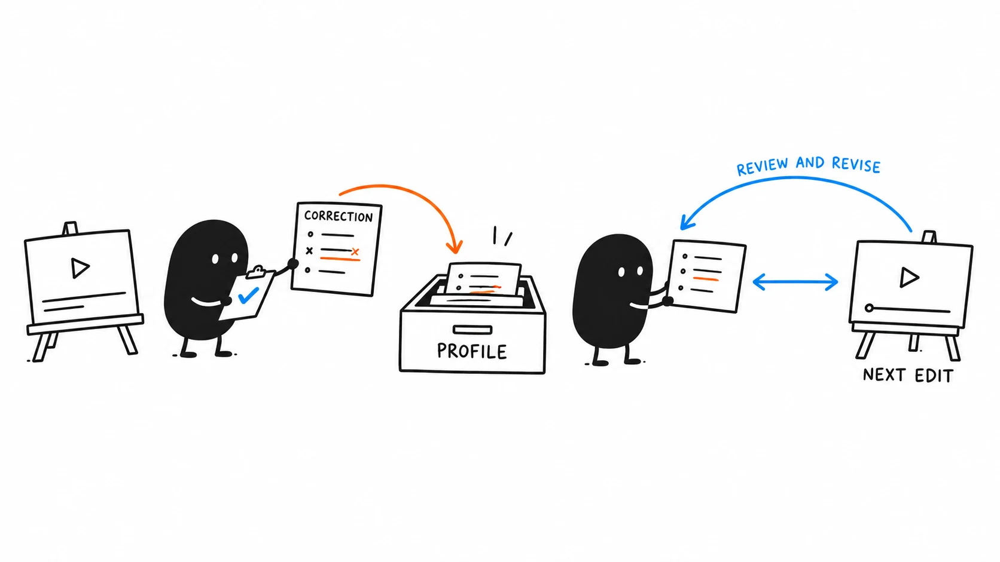

# 06 · Fix what needs changing

[Open the feedback image](assets/06-feedback.webp) · [Open the revision prompt](../../skills/edit/templates/core/EDIT%20PLAN%20AND%20REVIEW.md)

Reading time: about 2 min.

Name the version, timestamp, problem and change.



## 1. Point to the problem

The illustration moves a caption that covers the switch. Its timestamp is an example; use the time from your file.

```text
In [reviewed filename/version] at [timestamp], [describe the problem]. Change it to [describe the result you want]. Preserve the rest of the edit and keep the previous version recoverable. Save a new version, replay the changed section with sound and a few seconds on each side, and return the updated editable project and export.
```

Practice note: “In too-short.mp4, around 00:02, the click is missing. Restore it and the action from source.mp4 while keeping the shorter wait.” Compare with corrected.mp4.



## 2. Check the new version

Replay the repair. Are the words readable and the switch visible? Did nearby speech and action survive? You can dictate notes, or duplicate the timeline and make a small change yourself.



## 3. Keep the reason

Keep the accepted before-and-after versions and why the change helped. Lesson 8 turns useful corrections into preferences. This video’s exact caption position stays in its brief.

More detail: [Detailed feedback guide](../guide/13.md) · [Manual finishing](../guide/14.md) · [Saving preferences](../guide/15.md).

[Next: Export and check your video](07.md) · [All eight lessons](README.md)
